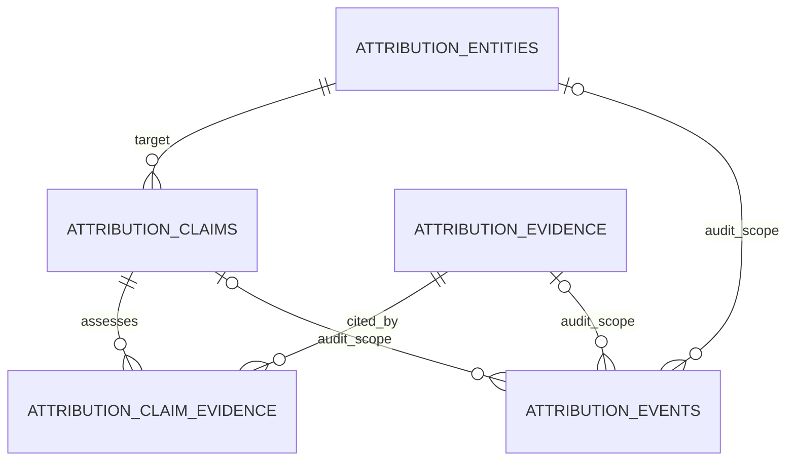

# Greedy Collector attribution architecture

Status: proposed design for review; no attribution implementation or migration. Audit date: 2026-09-12. Repository: `C:\Tools\Inventions\greedy-collector`. Starting application baseline: 242 tests. All table names, APIs, controls, and phases below marked proposed are future work, not currently available functionality.

## 1. Goals

Organize explicit, evidence-backed propositions about a supported blockchain address and an entity. An investigator must be able to inspect the proposition, its scope, creator, supporting and contradicting material, source provenance, current assessment, and assessment history. Preserve uncertainty and historical disagreement. A useful first release needs manual investigation workflows, not automatic identity discovery.

Select a small relational design for SQLite, SQLAlchemy, and Alembic. Keep blockchain collection, public-record research, annotations, attribution, and risk as separate operations. New attribution writes must not cause provider requests or mutate existing wallet, label, research, risk, or monitoring records.

## 2. Non-goals

No implementation in this task. No migrations, runtime changes, live-provider verification, or user-database changes. No automatic label conversion, name-to-wallet matching, ownership inference, identity fusion, clustering implementation, ENS resolution, source crawling, bulk discovery of a private person's wallets, private KYC acquisition, IP tracking, leaked credentials, or covert collection.

The future v1 organizes public/source material already obtained through GC or explicit analyst entry. It does not fetch arbitrary evidence URLs or store scraped page dumps. Commercial and privileged ingestion, access-control infrastructure, cryptographic identity verification, legal ownership adjudication, entity merging, and probabilistic scoring are outside v1. No Neo4j requirement or new frontend framework.

## 3. Terminology

| Concept | Meaning | What it does not establish |
| --- | --- | --- |
| Entity | A stable local record naming an organization, person, service, protocol, public body, or online identity | Creating the record does not prove that entity exists as described or controls an address |
| Subject | The thing about which the proposition is made; v1 is a chain-qualified wallet/address | A GC address record is neither a person nor a legal account |
| Attribution claim | One proposition: subject + bounded relationship + entity, with explicit time scope and assessment | A claim is not an assertion of established fact merely because it is stored |
| Evidence | An immutable, concise capture of cited material or analyst observation | Capturing material does not authenticate it or establish its truth |
| Source | The named publisher/origin and locator from which material was obtained | A URL, platform label, or credential-configured flag is not a reliability rating |
| Assessment | A recorded analyst judgment about how the current evidence bears on the precise proposition | Not a mathematical probability, identity match score, or wallet risk score |
| Label | Existing sourced address annotation, with type and stored confidence | Does not retain an attribution proposition or a complete evidence chain |
| Technical cluster | A future hypothesis relating blockchain subjects under a specified technical method | Does not identify a real-world actor |

An entity type is a display/organization aid, not an inheritance hierarchy or a risk class. Proposed vocabulary: `organization`, `person`, `service`, `protocol`, `public_body`, `online_identity`, `unknown`. An exchange may be a service distinct from its corporate operator. Do not merge those records by shared name. Aliases help analysts find candidates; they are not unique identifiers or automated match rules.

V1 subjects are exclusively `wallet` with `chain` and canonical address. Transactions can be cited as evidence; domains and names can be source locators or entity descriptors. They are not claim subjects in v1. ENS-name-to-wallet and wallet-to-cluster relationships have different subject/object types and are deferred to separately designed extensions.

## 4. Current-state audit

Authority is the inspected working tree, including existing uncommitted Labels and Research work. Links below are repository-relative code references. This is a code/schema audit, not an inspection of private database contents or a claim about external provider availability.

| Area and code | Current behavior / reusable parts | Attribution gap or reuse limit |
| --- | --- | --- |
| [Models](../greedy_collector/models.py): `Address` | UUID string ID; unique `(chain,address)`; string balance; risk summary; first/last activity; provider metadata; update time | Represents retrieved chain state, not identity. No owner/entity FK or evidence history. Exact-string key can retain Ethereum case variants. Do not create a fake balance-bearing Address row just to create a claim |
| `Transaction` | Normalized transfers, source API, timestamp, raw payload; unique `(chain,tx_hash,from_address,to_address,value_native,token_symbol)` | A transaction can contain multiple normalized transfers. Hash alone is not a complete evidence-record key. Blockchain activity alone does not establish the actor |
| `Label`; [schemas](../greedy_collector/schemas.py): `ManualLabelCreate`; [services](../greedy_collector/services.py): `import_labels` | Annotation fields address, chain, label, type, source, confidence, last_updated; unique `(chain,address,label,source)`. Manual default confidence .7; database model default .5. CSV updates type/confidence/time for the same key | No original capture/excerpt, publisher identity, support/contradiction, creator, or revision history. `any` is unvalidated chain scope. Existing confidence is not attributable identity probability |
| `Case`, `CaseEntity`, `AnalystNote`; [router](../greedy_collector/router.py) | Real cases, references, notes. CaseEntity has case FK, type/ref strings, metadata. API types: wallet, transaction, label, graph_snapshot, attachment. Notes have an author string | CaseEntity is not a real-world Entity. Polymorphic target ref has no target FK. New attribution types are currently rejected by schema; target existence is not generally validated. Author is not authenticated identity |
| Attachments | Case attachment route stores a sanitized filename below local data directory and a CaseEntity reference. Browser adds a unique filename prefix | No standalone evidence model, immutable content version, source authenticity, or attachment download endpoint. Do not reuse a filesystem path as an attribution-evidence identifier |
| `KycScreeningRun`, `KycMatch`; [research engine](../greedy_collector/kyc/engine.py) | Stored run query/time/source accounting and matches with source, subject, rationale, URL, categories, data, review status. Seven automated sources, 18 manual links; see [source audit](RESEARCH_CAPABILITIES.md) | Name/domain matching, no wallet subject. Review status is overwritten without a review event log. Match has no own captured/published timestamp; run time is available internally. No previous-run browsing API |
| [Research presentation](../greedy_collector/kyc/presentation.py); `services.kyc_screen` | Safe capability booleans; source error accounting; credential redaction before new run/match persistence; sanitized review responses | Not a general evidence access-control system. Historical material is not retroactively rewritten. Import handoff must sanitize and snapshot server-side rather than trust browser copies |
| `lookup_address` / `lookup_transaction` | Real provider retrieval; address lookup stores transfers, address state, risk result and retrieval provenance. Transaction lookup returns a normalized transaction without persisting it | Returned address history is bounded. first_seen/last_activity describe returned observations, not guaranteed lifetime history. A source API identifies retrieval origin, not actor identity |
| `address_graph`; [GraphStore](../greedy_collector/graph.py) | SQLite stored transaction traversal, hops 1–3; optional Neo4j mirror. Wallet nodes, directed transfer edges. [Frontend layout](../static/js/graph_layout.js) is stable by hop and aggregates visual connections while retaining returned records | No entity/attribution edges. SQLite traversal uses `transactions_by_hash`, so transfers sharing a hash can collapse before rendering. Helpers lower-case address keys, including Bitcoin. These are current presentation/retrieval limitations, not evidence completeness or identity guarantees; do not inherit them into claim keys |
| Label lookup / exposure | `_labels_for_transactions` retrieves by lower-cased address; risk consumes label evidence and stored exposure paths | Current helper does not chain-filter that label query. New attribution handoffs must explicitly require chain and exact canonical subject; do not reuse this helper for identity matching. No production fix is made here |
| [Risk engine](../greedy_collector/risk/engine.py) / `RiskResult` | Deterministic-v2 findings, evidence, category caps, saved scores. Sanctioned/Scam/Mixer counterparty exposure weighs 40/30/25; Exchange/Bridge context weighs zero. Current direct_evidence cap is zero | No attribution input. A finding's confidence and risk contribution are different concepts. Saved findings/scores are historical snapshots; never reinterpret them as ownership evidence or silently rescore |
| [Monitoring](../greedy_collector/monitoring.py) / alerts | Scheduled/manual wallet checks reuse lookup, persist runs and deduplicated alerts. Watches/alerts can reference cases | Watch label is display text. Monitoring alerts do not establish attribution. No need to connect attribution writes to these jobs, baselines, or dedupe keys |
| [Reporting](../greedy_collector/reporting.py) / `case_report` | Markdown, escaped HTML, JSON, PDF; case references, notes, alerts, disclaimer | Current reports enumerate references rather than dereference an evidence chain. No pinned attribution assessment or evidence inventory. `case_json` uses `default=str`; new snapshots need explicit JSON-safe serialization, not arbitrary object stringification |
| [Database](../greedy_collector/database.py), [migration environment](../migrations/env.py), [baseline migration](../migrations/versions/20260630_01_greedy_collector.py) | UUID String(36), UTC-generating datetime defaults, SQLAlchemy JSON, SQLite FK listener; Base metadata initialization; explicit immutable Alembic baseline `20260630_01` | `create_all` is called by service construction, does not upgrade existing tables, and does not install migration-only event triggers. Migration environment deliberately avoids package side effects. Future deployment must address migrated and legacy unversioned databases explicitly |
| [Resolver](../greedy_collector/resolver.py), [adapter base](../greedy_collector/chains/base.py) | Local syntax dispatch and adapter validation without provider requests | Address validators are format regexes returning trimmed text; they do not prove checksum validity, existence, or control. Do not describe successful validation as verified ownership |
| Frontend / tests | Same-origin vanilla modules, safe text rendering, explicit actions, TestClient + isolated SQLite fixtures; Node/Chromium smoke runner | No Attribution workspace or endpoints exist. Existing mutation routes and notes have no authenticated actor model or immutable attribution audit stream |

Datetime convention: existing paths use Python UTC datetimes, `jsonable_encoder`, `isoformat()`, and Pydantic serialization. SQLite can return naive datetimes despite timezone declarations. Future attribution output must normalize internal capture/event times to UTC and serialize ISO-8601 (e.g. `2026-09-12T08:00:00+00:00`); source date-only values remain `YYYY-MM-DD`. Do not silently assign exact times to date-only citations or use arbitrary `str()` conversions in evidence JSON.

Reuse the database/session machinery, local validators, common frontend components, explicit case selection, report formats, source catalog IDs, safe URL practices, and testing harness. Do not reuse old tables as substitutes for entities/claims/evidence/events. No audited limitation is fixed during this design task.

## 5. Selected data model

### Options considered

| Option | Tables / relationships | Advantages | Disadvantages | Migration / query cost / extensibility |
| --- | --- | --- | --- | --- |
| A: claim-owned evidence | entities → claims → evidence; events reference those objects; four tables | Smallest join count; simple claim detail; support/contradiction directly on evidence | Same source capture must be copied for multiple claims; duplicated corrections; copied records can be mistaken for independent sources; evidence reuse and case citations become awkward | Four additive tables; low query cost; later sharing requires evidence deduplication and link migration |
| B: reusable evidence plus claim links — selected | entities → claims; claims ↔ evidence through claim_evidence; scoped events; five tables | One immutable capture can support one claim and contradict another; independent rationale per link; explicit evidence identity; convenient future case references | One extra join and explicit link lifecycle; no automatic global correction propagation | Five additive tables, straightforward indexes; claim detail is bounded joins plus paginated evidence/events; future subject/entity sources can be added without rewriting evidence copies |

Select B. A separate Source table is unnecessary in v1: each immutable evidence capture retains a source citation snapshot. A publisher rename must not rewrite old citations. Source catalog IDs can be optional provenance hints, never hard FKs to the Python catalog. Dedicated publisher management can be added later if a demonstrated workflow needs it.

Each event has exactly one scope FK; the diagram does not mean an event targets all three. Claim-link events belong to the claim stream. Existing Address rows remain independently retrieved state, joined for display using a chain-aware canonical key rather than made a required parent.

## 6. Proposed table definitions

These are specifications only. Types below are SQLAlchemy types: S(n)=String(n), T=Text, DT=DateTime(timezone=True), D=Date, J=JSON, I=Integer, B=Boolean. `NN` means NOT NULL; `NULL` is explicit. All IDs use existing server-generated UUID strings. Defaults are specified below; unlisted defaults do not exist. Use named CHECK/UNIQUE/FK constraints. String lengths/nonblank text and JSON shape/size also require Pydantic/service validation because SQLite does not enforce VARCHAR lengths. Every FK uses `ON DELETE RESTRICT` and no update cascade; identifiers never change.

### 6.1 `attribution_entities`

| Column | Type / null | Default / rule |
| --- | --- | --- |
| id | S(36) NN PK | new_id() |
| canonical_name | S(255) NN | Trimmed, nonblank; display name, not a unique real-world identifier |
| name_key | S(255) NN | Server-derived Unicode NFKC + casefold + collapsed whitespace; search only |
| entity_type | S(32) NN | `unknown`; CHECK vocabulary in section 3 |
| description | T NN | Empty string; max 8,000 characters; concise descriptor, not evidence repository |
| aliases | J NN | []; up to 50 nonblank strings of at most 255 characters; no automatic merging |
| created_by | S(128) NN | Server actor reference, v1 `local_analyst` |
| created_at | DT NN | Server UTC now |
| updated_at | DT NN | Server UTC now, advanced on mutation |
| archived_at | DT NULL | NULL; only archive/restore workflow changes this |
| version | I NN | 1; CHECK >=1; optimistic concurrency |

Indexes: `(name_key,id)` and `(archived_at,entity_type,id)`. Only ID is unique: two entities can share a name/type. No FKs. Website/domain references live as source citations in evidence initially; adding an unverified website to an entity row would blur description and proof. UI may derive cited domains with their evidence IDs, never present them as verified official sites merely by association.

### 6.2 `attribution_claims`

| Column | Type / null | Default / rule |
| --- | --- | --- |
| id | S(36) NN PK | new_id() |
| subject_type | S(16) NN | `wallet`; CHECK equals wallet in v1 |
| chain | S(32) NN | CHECK bitcoin / ethereum |
| subject_ref | S(128) NN | Server-canonical address, validated locally; immutable |
| entity_id | S(36) NN FK | attribution_entities.id; immutable |
| relationship | S(32) NN | CHECK vocabulary in section 7; immutable |
| valid_from | D NULL | Earliest asserted day, or unknown |
| valid_to | D NULL | Latest asserted day, or unknown; CHECK >= valid_from when both known |
| scope_note | T NN | Nonblank, max 4,000; explains temporal limits, shared custody, and exact meaning |
| assessment | S(32) NN | `unassessed`; CHECK vocabulary in section 9 |
| assessment_rationale | T NN | Empty until assessed; max 8,000 |
| assessed_at | DT NULL | NULL until assessment action |
| assessed_by | S(128) NULL | NULL until assessment action; actor snapshot |
| needs_review | B NN | True; see invalidation rules below |
| created_by | S(128) NN | Server actor; v1 analyst only |
| created_at | DT NN | Server UTC now |
| updated_at | DT NN | Server UTC now |
| archived_at | DT NULL | NULL initially |
| version | I NN | 1; CHECK >=1 |

UNIQUE `(subject_type,chain,subject_ref,relationship,entity_id)` applies to active, rejected, and archived claims alike. Indexes: `(chain,subject_ref,archived_at)`, `(entity_id,archived_at,id)`, `(assessment,needs_review,updated_at,id)`. Non-unassessed assessment requires nonblank rationale, assessed_at, assessed_by. Assessed_at/by are both NULL or both populated. A later reset to unassessed may retain its reset actor/time; old assessments always remain in events.

No FK to addresses: a claim may exist before a blockchain lookup. No inserts into addresses, no fake balance, no provider access. The validated subject type and chain are explicit even though only wallet is enabled. Adding other subject types later requires new validation, canonicalization, allowed relationship/object combinations, and a reviewed migration; arbitrary polymorphic values are rejected today.

### 6.3 `attribution_evidence`

Immutable after insertion. No update/delete API. Capture material once, then link it to claims. All fields including provenance are snapshots.

| Column | Type / null | Default / rule |
| --- | --- | --- |
| id | S(36) NN PK | new_id() |
| evidence_type | S(32) NN | CHECK official_disclosure / public_record / explorer_annotation / public_post / repository_record / research_snapshot / label_snapshot / analyst_observation |
| title | S(255) NN | Nonblank |
| summary | T NN | Nonblank; max 8,000 characters |
| excerpt | T NULL | Concise cited excerpt, max 8,000; not a page dump |
| source_name | S(255) NN | Nonblank publisher/origin; use explicit Analyst observation where appropriate |
| source_url | T NULL | Validated HTTP(S) citation, max 2,048; no userinfo or credentials; never fetched by this API |
| source_locator | S(512) NULL | Filing/page/record/post ID or other precise citation when URL absent or insufficient |
| source_catalog_id | S(128) NULL | Existing source ID when applicable; no FK to runtime catalog |
| origin | S(32) NN | CHECK public_osint / analyst_added / commercial_proprietary / privileged_nonpublic; write policy below |
| collection_method | S(32) NN | CHECK analyst_entry / label_snapshot / research_snapshot; server-derived for handoffs |
| published_on | D NULL | Source publication date if known; never inferred from capture time |
| observed_on | D NULL | Date material/activity was observed if known; chronology can differ from publication |
| captured_at | DT NN | Server capture time; not the original publication or research-run time |
| captured_by | S(128) NN | Server actor reference |
| analyst_note | T NN | Empty string; max 8,000 |
| source_reliability | S(16) NN | unassessed / reliable / uncertain / unreliable; default unassessed |
| reliability_rationale | T NN | Empty by default; required when reliability is assessed |
| origin_group | S(128) NULL | Analyst-noted common underlying origin to identify copied/dependent sources; not an independence calculation |
| origin_label_id | S(36) NULL FK | labels.id, RESTRICT |
| origin_match_id | S(36) NULL FK | kyc_matches.id, RESTRICT |
| metadata_json | J NN | {}; schema-limited JSON object, max 32 KiB UTF-8 after safe serialization |
| content_sha256 | S(64) NN | Server fingerprint of sanitized citation/content; rule below |

CHECK: label_snapshot collection requires origin_label_id and no origin_match_id; research_snapshot requires origin_match_id and no origin_label_id; analyst_entry requires neither. CHECK matching evidence_type for the two snapshot methods. At least one locator (URL or source_locator) is required except for analyst_observation, which requires a specific observation summary and analyst_note. A label snapshot can use `label:<id>` as its internal locator; it remains a secondary annotation if the original source is vague.

Indexes: `(captured_at,id)`, `(content_sha256)`, `(source_catalog_id,captured_at)`, `(origin_label_id)`, `(origin_match_id)`, `(origin_group)`. No unique URL/hash constraint: one URL can change over time and identical text can be copied by different publishers. Hash equality is a duplicate warning, not corroboration or authenticity.

For v1, writes accept public_osint and analyst_added only; the other two enum values are reserved, rejected with a safe 422 until an explicit access/export/ingestion policy exists. A provenance category is not access control. No privileged material is collected or displayed by v1.

### 6.4 `attribution_claim_evidence`

| Column | Type / null | Default / rule |
| --- | --- | --- |
| id | S(36) NN PK | new_id() |
| claim_id | S(36) NN FK | attribution_claims.id |
| evidence_id | S(36) NN FK | attribution_evidence.id |
| stance | S(16) NN | CHECK supports / contradicts / context |
| directness | S(16) NN | CHECK direct / indirect / context; analyst selected |
| rationale | T NN | Nonblank, max 8,000; why this material bears on this exact proposition |
| added_by | S(128) NN | Server actor |
| added_at | DT NN | Server UTC now |
| updated_at | DT NN | Server UTC now |
| withdrawn_at | DT NULL | NULL initially; withdrawal retains the row |

UNIQUE `(claim_id,evidence_id)`. Index `(evidence_id,claim_id)` supports reuse inspection; `(claim_id,withdrawn_at)` supports active evidence. Link changes/withdrawal/restoration are audited in the claim stream and use the parent claim version; no separate link version. A context stance requires context directness. Other combinations require an explanation: a direct contradiction is possible. Role belongs here, not on Evidence, because the same record can have different implications for different propositions.

### 6.5 `attribution_events`

One append-only table provides three narrowly scoped streams, not an enterprise audit platform.

| Column | Type / null | Default / rule |
| --- | --- | --- |
| id | S(36) NN PK | new_id() |
| entity_id | S(36) NULL FK | attribution_entities.id |
| claim_id | S(36) NULL FK | attribution_claims.id |
| evidence_id | S(36) NULL FK | attribution_evidence.id |
| sequence | I NN | CHECK >=1; one-based within target stream |
| event_type | S(32) NN | CHECK created / descriptor_changed / scope_changed / evidence_linked / evidence_changed / evidence_withdrawn / evidence_restored / assessment_changed / review_required / archived / restored |
| actor_kind | S(16) NN | CHECK analyst / system; public v1 writes analyst only |
| actor_ref | S(128) NN | Server actor, never trusted from a request body |
| occurred_at | DT NN | Server UTC now |
| reason | T NN | Nonblank max 8,000; concise command/assessment reason |
| payload | J NN | Versioned schema `{schema_version:1,before:...,after:...}`; touched fields/rows only, not raw source dumps |

CHECK exactly one target FK is non-NULL. Three UNIQUE constraints `(entity_id,sequence)`, `(claim_id,sequence)`, `(evidence_id,sequence)` give per-stream ordering; NULLs in other scopes do not define a competing identity. Index `(occurred_at,id)`; scope UNIQUE indexes support history paging. Services validate allowed event type for target (evidence has only created in v1). Entity/claim version equals their latest event sequence. Evidence has creation event sequence 1 and never mutates.

Future migration must install SQLite BEFORE UPDATE/DELETE rejection triggers for immutable evidence and event rows; inserts remain transactional with services. Add equivalent SQLAlchemy write restrictions for clear application errors. Fresh supported installations run migrations, including triggers; `create_all` alone is not an equivalent audit setup. This is application/database auditability, not tamper-proof evidence against the machine/database administrator. No cryptographic non-repudiation claim.

### 6.6 Mutation and deployment rules

Entity and claim mutations require `expected_version`. Use an atomic update conditioned on that version; losing writers return 409 and roll back their link/event work. A command changing one target increments its version once and appends one event containing all touched state. Multi-target operations (such as entity descriptor revision invalidating claims) append one event per affected target in one transaction. Link IDs and before/after rationale, stance, withdrawal state belong in the claim event. Creating evidence + linking it must commit all records/events or none.

Material changes (link add/change/withdraw/restore, claim scope change, entity descriptor change) set affected claims' needs_review=True. The old assessment stays visible as last assessment, explicitly stale; it must not be presented as current support. The subsequent explicit assessment reviews the current version and clears needs_review. Archive does not change truth assessment; restore requires review. Entity archive excludes all its claims from default active views without rewriting their evidence. Assessment events include the reviewed active link IDs, evidence IDs, stances, directness, and entity version so the judgment can be reconstructed.

Future AT-1 migration is additive after `20260630_01`; never rewrite the baseline. Dry-run on a copy and verify FK checks, triggers, indexes, and old row counts. Legacy databases created with create_all but not stamped must first be compared to the baseline schema; only a verified equivalent database can be explicitly stamped before upgrade. Do not blindly stamp or run the baseline CREATE TABLE operations over populated tables. Future startup needs an attribution schema/version check and a clear migrate-required error **before service construction can create new Base tables**; AT-1 must provide that explicit migrated startup path rather than relying on today's import-time create_all. It must not silently bypass trigger installation. Downgrade that would destroy attribution history is disallowed on a populated attribution database unless handled by a separately approved backup/export recovery procedure. No migration is created now.

## 7. Claim semantics

Initial vocabulary is intentionally small:

| Relationship | Precise proposition | Minimum interpretive boundary |
| --- | --- | --- |
| operated_by | Entity is asserted to operate this address for the stated function/time scope | Does not establish beneficial or legal ownership, sole custody, or end-customer identity |
| controlled_by | Entity is asserted to have the specified transaction authorization/control capability | Scope must distinguish shared/multisignature/delegated control; no automatic sole-control inference |
| publicly_declared_by | An attributable public statement by the entity explicitly designates this address | Proves only the claimed disclosure if supported; does not itself prove keys, ongoing control, or legal ownership |

Exclude `owned_by` from v1: it asserts a different, stronger legal proposition. Also exclude vague `associated_with`, `deposit_address_of`, and `service_wallet_of`; operational function can be scoped in an operated_by claim without proliferating ambiguous predicates. A transfer to an address is not a publicly_declared_by statement or proof of operation. Relationships do not imply one another; a disclosure claim must not silently generate a control claim.

Creation always starts unassessed with needs_review=True; an evidence-free draft is allowed. The API cannot create a pre-assessed claim in the same request. Multiple analysts/sources normally contribute evidence and events under the same tuple, not competing copies of an identical proposition. Duplicate POST returns 409 with existing_claim_id, including if archived or rejected. Restore/reassess explicitly. Different entity or relationship means a separate claim; show competing active claims on the same wallet. Multiple claims are not votes or evidence independence.

Normalize surrounding whitespace through existing local validation. Ethereum subject_ref uses lowercase hex; keep any supplied checksum spelling only as optional capture metadata, not a second identity. Bitcoin Base58 is case-sensitive and must retain case; accepted Bech32 input is normalized only within that accepted address form. Current regex validation is the acceptance baseline, not full checksum validation. Reject unsupported chains and chain `any`; never copy the graph's blanket lowercase key logic. The same textual address on different chains is a different subject. This canonical key can exist before any Address row; later wallet joins must explicitly handle existing case variants without changing those rows.

valid_from/valid_to are analyst-stated bounds at day precision, not assertions inferred from wallet first_seen/last_activity. NULL means unknown, not perpetual current control. V1 retains one current scoped proposition per tuple; revising its scope is an audited change requiring reassessment. Disjoint historical control intervals are read through event history and cited evidence, not silently combined into continuous control. A future need to compare independently assessed disjoint intervals requires an explicit interval model extension. Entity/relationship/subject mistakes require archiving/rejecting that claim and creating the corrected tuple; never rewrite identity fields or erase the mistake.

## 8. Evidence and provenance model

Separate capture from interpretation. A capture has a source, locator, concise material, dates, actor, collection method, origin class, reliability judgment, and a stable ID. Its link to each claim says supports/contradicts/context and why. Two websites reproducing one disclosure are not independent corroboration; preserve their separate locators and set a common origin_group or explain dependence in rationale. Independence is assessed, not calculated from row count or domain count.

For an official notice, preserve title, issuing source, URL plus document/page reference, publication date if known, and the short passage connecting the exact address to the entity. A repository capture should cite commit/permalink rather than only a mutable branch URL. Social/explorer material should retain exact post/record locator and observation date. Source labels such as official are analyst claims requiring a reason, not authority automatically assigned by hostname. Court/seizure material must be interpreted for the actual entity, relationship, and period it states; being mentioned in a filing is not necessarily evidence of operation.

Capturing a research match uses a server-read KycMatch and parent run. Store their IDs, query, run created_at, captured review status, source/rationale/score/categories, and selected safe source data in metadata. Original run time is distinct from new captured_at; match review status and similarity retain their original semantics. A label capture includes its complete safe annotation fields, ID, last_updated, and source text. Future changes to those source records do not change the captured evidence.

Fingerprint canonical sanitized citation/content using UTF-8 JSON with sorted keys, compact separators, ensure_ascii=False, allow_nan=False after explicit JSON-safe conversion. The hashed object includes type/title/summary/excerpt/source fields, dates, origin/method, reliability/note/group, origin IDs, and metadata; excludes generated evidence ID, captured_by, captured_at, and content_sha256. This identifies identical stored material across captures, not authenticity, completeness, or external chain of custody. No page is automatically downloaded to calculate it.

Sanitize at the future service boundary before hashing, JSON-column insertion, logging, and response. Reuse the research redaction approach where applicable, with explicit attribution schemas. Reject credential-bearing source URLs; use safe HTTP(S) links and noreferrer/noopener. Do not permit arbitrary filesystem locators, active HTML, browser-controlled internal IDs, or raw exception output. Store source excerpts as text; escape HTML/PDF/report contexts. Reject oversized input explicitly rather than silently truncate evidence. Known full timestamps in metadata use ISO-8601 with their recorded offset/UTC; unknown dates remain null.

Source reliability is a human assessment of this capture/origin, separate from claim strength and directness. `reliable` needs a reason describing origin/authentication checks; it does not mean every statement is true or independent. Changing that judgment creates a new evidence capture and explicitly replaces links; original snapshots remain inspectable. No global silent rewrite of evidence relied on by other claims. Reuse inspection lists every linked claim so an analyst can review each affected claim explicitly.

Origin classes describe provenance, not truth or access rights. `public_osint` means publicly obtained source material; `analyst_added` means the material itself is a local analyst observation/assertion, not merely that someone clicked Add. `commercial_proprietary` and `privileged_nonpublic` are reserved for later governed support, not ingestion routes or empty access-control promises in v1.

## 9. Assessment and confidence model

Select categorical analyst-assigned assessment plus a mandatory rationale; no numeric claim confidence. This is simpler than a category and an uncalibrated number expressing the same judgment. Never copy label confidence, KYC similarity, risk scores, or source counts into it.

| Stored category / display | Criteria |
| --- | --- |
| unassessed / Unassessed | Draft or explicitly reset; no current analyst conclusion. Not evidence that no relationship exists |
| possible / Possible | Some relevant supporting material exists but linkage, reliability, scope, or contradictions remain unresolved |
| supported / Supported | Analyst identifies at least one direct supporting capture, explains source reliability and time scope, and addresses all active contradictions; conclusion remains a claim |
| strongly_supported / Strongly supported | Direct, authoritative/primary material explicitly connects this exact subject, entity, relationship, and scope; analyst documents origin checks and why remaining contradictions do not defeat it. Multiple weak heuristics never satisfy this standard |
| rejected / Rejected | Analyst finds the proposition unsupported or contradicted and records why; draft mistakes can be rejected without external evidence. Not automatically proof that every competing claim is true |

`Unattributed` is a view state when no active current supporting claim exists, not a row/status. `Confirmed` is deliberately excluded: even self-disclosure, a legal record, or a signature must be evaluated for scope, authenticity, shared control, and time. If introduced later, it needs an explicit, separately reviewed ground-truth/verification standard and must remain relationship-specific. Do not relabel Research's Confirmed source match as confirmed attribution. Strongly supported is the v1 ceiling, not a euphemism for legally proven ownership.

Assessment command guards: Possible requires at least one active supports link. Supported/Strongly supported require a direct supports link whose evidence reliability is assessed, and explicit rationale; Strongly supported requires at least one such capture assessed reliable with primary/direct source verification described. Commands must acknowledge all active contradicts link IDs and provide a conflict discussion in the rationale. Rejected and Unassessed need a reason but no supports link. Structural checks can require fields and references; they cannot prove the analyst read the source or that it is true.

Every assessment action must name the version reviewed and current active link IDs. Any stale expected_version yields 409 without updates. Every later material change flags needs_review. In lists, graphs, reports, and downstream uses, show “Last assessment: Supported — review required” rather than an unqualified Supported badge. Only non-archived claims and entities with needs_review=False are eligible for a current assessed overlay; no numerical conversion or automatic upgrades. Analysts can move in either direction, including Strongly supported → Rejected, with all previous reasons retained.

Worked policy examples (illustrative reasoning only, never runtime data): an explorer annotation alone may justify Possible, not Strongly supported. An authentic entity disclosure designating an exact address may strongly support publicly_declared_by while only providing indirect evidence for controlled_by. A shared-custody record may contradict exclusive control without contradicting that a service operates the address. Three copies of one social post remain one underlying origin, not three independent proofs.

Future automated scoring would require a versioned, explainable rubric, validated labeled evaluation data, source-dependence handling, conflict and temporal semantics, measured error rates/calibration if probabilities are claimed, and human override/history. None is designed as a hidden weighted formula here. V1 uses analyst judgment only.

### Audit, archival, and historical interpretation

Entities and claims are archived/restored, never hard-deleted through the API. Rejected is an assessment, archived is lifecycle; both can coexist. Evidence remains immutable; remove it from a current assessment by withdrawing the claim link with a reason. Correct errors by capturing replacement material and explicitly withdrawing/replacing relevant links in one versioned claim command. Unlinked/withdrawn evidence remains inspectable by ID and in history; no destructive orphan cleanup. No global evidence-delete or global retarget operation.

Creation, descriptor/scope edits, evidence link changes, assessment changes, archive/restore, and review invalidations generate transactional events. Payloads retain old/new values sufficient to reconstruct state at a version. No UPDATE/DELETE events API; future database triggers reject direct ordinary row edits/deletes of events/evidence. No destructive cascade from entity, claim, label, or KYC source rows. Future label/KYC deletion features must respect evidence references or explicitly design a retained origin tombstone; they cannot quietly break provenance.

Who made a claim is represented honestly: the current application has no authentication. V1 records server-supplied `local_analyst`, explicitly displayed as an unauthenticated local operator identity. It does not promise attribution to a verified person or use browser-supplied author as authentication. System events identify the responsible service operation; future authenticated actors can use stable principal IDs without rewriting past actor snapshots. DB administrators can alter the database outside application guarantees; external signing or enterprise audit is deferred.

## 10. Label integration

Choose option B: keep labels separate and allow an explicit **Use as evidence** handoff for a selected record. No mass migration, automatic candidate generation, entity matching, or confidence promotion. Do not change label CRUD/CSV or calibrated risk behavior.

Future workflow: choose an existing claim or create an unassessed claim with an explicit entity and chain-qualified wallet; server loads the selected label ID; show its source/confidence/timestamp and ask why it supports, contradicts, or contextualizes this proposition; capture the safe snapshot and link it. A label on the same wallet still does not prove that its text names the intended legal entity. A label on another wallet defaults to context unless the analyst explicitly explains relevance. `any` requires the analyst to select and locally validate the target chain; it never fans out to multiple chains. Source text Manual analyst label remains an annotation origin, not an official disclosure.

The snapshot's label confidence stays under source metadata, labeled annotation confidence. An entity search may suggest existing names for manual selection; no name match auto-selects or merges one. CSV updates after capture do not retroactively change the evidence or assessment.

## 11. Research integration

Future **Add as evidence** starts from a real stored match ID. Analyst chooses/creates the entity and explicitly chooses a wallet claim, then explains the evidential connection. The server loads match/run data, sanitizes, snapshots, and links atomically. Do not trust a pasted browser score, source URL, or identity label as authoritative stored data.

A registry hit establishing that Company X exists is normally context for a wallet claim unless the cited material also links the exact address and relationship. No automatic name → wallet discovery, no label creation, and no entity creation when screening runs. Research's Confirmed source match and similarity remain source-review metadata, not claim assessment.

This handoff can be implemented without a large KYC history API: the current result supplies an ID which the server can resolve internally; the evidence snapshot preserves what was used. Missing IDs return safe 404. An attribution detail links its stored snapshot and source citation rather than promising an unsupported previous-run browser. Existing screen/review operations never mutate attribution.

## 12. Graph integration

Add an optional, explicit attribution overlay in a future phase. Preserve transaction edges and the current blockchain hop semantics. Attribution edges are not transaction edges, do not advance transaction hop depth, and do not expand provider collection.

Use typed namespaced IDs: `wallet:<chain>:<canonical_address>`, `entity:<uuid>`, `claim:<uuid>` for overlay edges. Wallet nodes retain short and full-address access; entity nodes use a visually distinct shape and explicit Entity badge. Never replace or merge wallet nodes into an organization name. An entity can connect to several wallet nodes, each through its own claim and assessment.

Wallet → entity arrows label the relationship and assessment on selection. Transaction edges retain amount/hash direction. Attribution lines use a distinct stroke/pattern and legend; Possible/review-required uses dashed styling, Supported/Strongly supported can use a separate solid style with literal badges. Color alone is insufficient. No “confirmed vs inferred” shorthand in v1 because Confirmed and automatic inference are not enabled. Rejected/archived claims are excluded from the default overlay but available through an explicit history filter with unmistakable status.

Layout entity nodes in a separate annotation band adjacent to their related wallet layer; keep wallet positions/hop grouping deterministic. Multiple claims remain separately inspectable rather than aggregate counts suggesting proof. Selecting a claim opens evidence and contradictions, selecting an entity lists independently assessed wallet claims. No automatic collection on node selection. Existing graph hash-collapse and lowercase limitations must be addressed or guarded by focused regressions before joining overlays; the overlay must never assert complete blockchain coverage.

Entity-centric view: canonical name/type/aliases and descriptor history; **Claims about wallets** with address, relationship, scope, last assessment/review state, and evidence counts separated by stance; evidence references; explicitly linked cases. Avoid “Known wallets” as an unconditional heading. Shared evidence is listed once with its per-claim roles; shared entity name never causes cluster merging.

## 13. Case and report integration

Smallest future case extension: add `entity`, `attribution_claim`, and `attribution_evidence` to CaseEntityCreate and the existing case UI dispatcher. Use the corresponding new UUID as entity_ref. Validate target existence and typed metadata server-side for these new types. CaseEntity's generic ref does not provide a database target FK; no-hard-delete semantics and target validation make it adequate for this increment. Do not overload label or graph_snapshot. A future requirement for database-enforced polymorphic targets would justify separate link tables, not one today.

On explicit attachment, store a server-generated reference snapshot in metadata: schema_version, target ID, capture time, entity version, claim version, relationship/scope, assessment plus needs_review, and linked evidence IDs/roles at that version. Evidence IDs point to immutable captures. Do not allow clients to forge pinned assessment metadata. Multiple attachment snapshots to the same target can be legitimate at different times; UI shows pinned version and date rather than pretending they're duplicate independent claims.

Report builder should materialize a consistent case snapshot within one read transaction, dereference the referenced events/evidence, and produce equivalent Markdown/HTML/JSON/PDF content. Show exact wallet/chain → relationship → entity, time scope, assessment as of the attached version, analyst/rationale, supporting citations, contradicting citations and their disposition, context separately, and whether the live claim has since changed/requires review/is rejected. Do not silently substitute the current assessment for a pinned one. Evidence withdrawn after a pinned assessment remains visible with historical and current status. Never drop contradictions to make a report cleaner.

Use explicit ISO-8601 conversion for new report snapshots and safe escaping. Content fingerprints describe stored excerpts, not authenticated website archives. No automatic reports, case assignment, or attachment of every entity's wallets. Cases/reports remain unchanged until their explicit phase.

## 14. Risk boundary

Attribution strength answers how evidence supports a relationship. Risk answers which configured investigative indicators apply to returned/stored activity. No mapping from assessment/confidence to risk points, no risk from a known organization name, no label creation as a side effect, no historical rescoring, and no monitoring/alert changes in attribution v1.

A strongly supported service operator claim can coexist with Low risk. A later sanctions-related risk policy would need separately sourced, time-qualified designation evidence and an explicit rule defining which assessed relationships and conflicts it accepts. It would cite claim/evidence versions and explain its own risk contribution, rather than treat the entity type or attribution score as suspicious. Such a rule needs separate approval/calibration and is not part of AT-1 through AT-6. Labels currently used by risk remain unchanged.

## 15. Clustering and future heuristic boundary

Technical cluster assertions are a separate future model: versioned method/run, chain, member addresses, relationship hypothesis, parameters, supporting transactions, exceptions, and observed time range. A cluster ID is not a person/organization Entity ID. A label/name must not be propagated through a common-input or other heuristic as real-world identity.

Future heuristic output should be marked **Inferred technical relationship**, with method/version and evidence dependencies. It cannot directly set Supported/Strongly supported attribution. A future rule-created wallet-to-entity candidate would require a newly reviewed creation origin (`rule` plus rule/version/run and explicit premises), start unassessed, remain distinguishable from analyst origin, and require explicit analyst assessment. Public v1 requests cannot submit actor_kind=system to bypass this boundary. Do not extend attribution_claims to accept arbitrary cluster subjects today.

No common-input logic, CoinJoin detection, pathfinding, identity discovery, or entity fusion is implemented/designed as a working algorithm here. AT-7 is a separately authorized architecture gate, not a commitment to implement a clustering engine after AT-6.

## 16. Proposed API design

All paths below would use existing `/api/greedy-collector` prefix. They do not exist now. Proposed services own validation, transactions, canonicalization, evidence capture, and audit events; routes stay thin. No endpoint fetches an evidence URL or provider data.

| Method / suffix | Workflow |
| --- | --- |
| GET /entities | Local name/type/archive filtering; bounded cursor pagination; no external entity resolution |
| POST /entities | Explicit local entity creation; warn about same-name candidates but allow distinct entities |
| GET /entities/{id} | Descriptor/version and paginated claims/evidence references; archived status explicit |
| PATCH /entities/{id} | Versioned descriptor edit or archive/restore; reason required; invalidate linked claim reviews on descriptor change |
| GET /entities/{id}/events | Paginated immutable descriptor/lifecycle history |
| GET /attributions | Filter chain+subject, entity, relationship, assessment, review/archive state; pagination |
| POST /attributions | Explicit unassessed wallet claim; existing entity required; duplicate returns 409 with ID |
| GET /attributions/{id} | Claim/current version, stance counts, scope, review state, related competing claims; no silent evidence truncation |
| PATCH /attributions/{id} | Versioned scope or archive/restore command only; immutable identity fields rejected |
| GET /attributions/{id}/evidence | Paginated active/withdrawn links and immutable capture details; filters by stance |
| POST /attributions/{id}/evidence | Attach existing evidence_id OR capture analyst material OR capture origin_label_id/origin_match_id; exactly one source variant; parent version and link rationale required |
| PATCH /attributions/{id}/evidence/{link_id} | Versioned stance/rationale/directness change, withdraw/restore, or explicit replacement capture; old evidence/link history retained |
| POST /attributions/{id}/assessments | expected_version, category, rationale, reviewed link IDs and acknowledged contradictions; appends event and updates assessment atomically |
| GET /attributions/{id}/events | History ordered by sequence; supports inspection of a pinned version |
| GET /attribution-evidence/{id} | Immutable citation, origin snapshot, and paginated where-used claim references; no generic scrape/ingest endpoint |

No DELETE endpoints, arbitrary PATCH dictionaries, public events-write API, giant evidence-library CRUD, or previous-research-run API is needed. Entity creation and claim creation are explicit separate actions; evidence capture+attachment is atomic so an interrupted handoff cannot leave an apparently assessed claim or partial link.

Bodies forbid unknown fields; actor/timestamps/hash/normalized subject are server-derived. Use exact enums and documented limits. Return JSON-safe named response objects with IDs, versions, lifecycle and review state. Lists default 50, max 200, stable `(created_at,id)` cursors (events use sequence); evidence listing exposes total and next_cursor. Do not silently hide links when a page limit is reached. Fetch current full active link IDs before assessment; the server checks the version and exact set. Review submission size limits are explicit safe 422 responses, not silent omissions.

Proposed statuses: 201 create, 200 read/mutation, 404 missing local reference, 409 duplicate/stale version/archived target conflict, 422 unsupported subject/relationship/invalid provenance/assessment preconditions, generic safe 500 rollback. A repeated attachment of the same evidence returns 409 with existing link ID; explicit restoration handles withdrawn links. Retries of new captures can warn on identical content hash but never infer source independence. API errors do not echo arbitrary pasted input, credentials, SQL, or local paths.

## 17. Proposed UI and analytic integrity

Add a future **Attribution** workspace using vanilla modules and existing components. Two primary tabs: Claims and Entities. Claim detail contains the exact proposition, scope, last assessment/current-review banner, Supports / Contradicts / Context evidence, assessment form, and history. Evidence opens a concise citation card with expandable structured metadata. No preselected positive assessment or default confidence number.

Wallet adds a clearly titled Attribution panel with claim count, relationship, entity, scope and review status, plus explicit Create claim. Preserve labels and risk in separately named sections. Graph offers the optional overlay described above. Labels offers Use as evidence; Research offers Add as evidence; Cases offers Add attribution with an explicit target case and pinned version. These actions choose/create the entity and claim deliberately; no name match silently completes the workflow.

Use “Claimed operator”, “Attributed entity”, “Assessment”, “Evidence”, “Shared control scope”, and “Last assessment — review required”. Do not render “Owner: Person X”, a verification checkmark, a percentage identity probability, or an unqualified “Known wallet”. Keep full wallet and entity IDs inspectable. Never collapse competing claims into the highest-rated name or hide rejected history. Public-record matching does not imply attribution even when its own review status says Confirmed source match.

Assessment submission presents every active contradiction and requires a reason addressing it. Archive/withdraw controls explain that material remains in history. URL/copy actions never trigger collection; provider lookups remain explicit existing wallet actions. Local entity search queries only already stored entities, not people-search providers. Person entity records require the same evidence and scope standards; no extra discovery workflow is introduced.

## 18. Implementation phases

Each phase requires a separate implementation task and a green full suite. This design authorizes none of them automatically.

| Phase | Bounded delivery | Exit criteria |
| --- | --- | --- |
| AT-1 | Five models, additive Alembic migration, immutable triggers, canonical subject utility, versioned transaction/event service basics, migration/startup guard | Empty and legacy verified baseline copies upgrade; old rows unchanged; FK/unique/CHECK/trigger enforcement; rollback and concurrency tests; no provider requests |
| AT-2 | Manual entities/claims/evidence/assessment APIs, pagination, safe responses and server actor provenance | Duplicate/reuse, contradiction, all assessments, archive/restore/history, byte limits, serialization, unsupported origins, and stale-write tests; labels/research unchanged |
| AT-3 | Attribution Claims/Entities workspace and entity-centric detail | Isolated browser create/review/withdraw/reject/history flows; safe language, no fake runtime data, no hidden provider calls |
| AT-4 | Wallet claim panel and explicit graph attribution overlay | Typed chain-aware IDs; retained wallet addresses, edge kinds and hop semantics; regression guard for graph transfer-key/case assumptions before reuse; no collection on selection |
| AT-5 | Explicit Labels/Research evidence handoffs | Server snapshots preserve original source/score/date meanings, no auto claims/entities/labels, no changes to source records, missing-reference and cross-chain tests |
| AT-6 | New case reference types, pinned assessment/evidence snapshots, report sections | All four report formats preserve contradictions and pinned versions; current-change warnings; no arbitrary client snapshot metadata |
| AT-7 (deferred design gate) | Separate technical-clustering/heuristic provenance proposal only if requested | Clear technical-vs-identity boundary, reviewed method semantics and independent test plan before any algorithm implementation |

AT-2 through AT-4 can deliver useful manual attribution without research handoffs or cases. Do not delay the core for entity merging, proprietary feeds, scoring automation, or history dashboards unrelated to claims.

## 19. Future test strategy

Reuse pytest, SQLAlchemy sessions with SQLite FK enforcement, FastAPI TestClient, and the existing isolated Chromium/Node workflow. Provider methods and external HTTP fail if called by attribution tests. Fixtures belong only under tests; no production seed claims/entities/evidence.

| Area | Required assertions |
| --- | --- |
| Creation / identity | Draft starts unassessed; existing entity reused explicitly; two same-name entities allowed; BTC/ETH canonical subject keys and cross-chain separation; no Address insert/provider request |
| Duplicates / concurrency | Same tuple conflicts across active/rejected/archived state; different relationships/entities allowed; simultaneous writes yield one success/one 409 with no orphan evidence/event; repeated link behavior explicit |
| Evidence | Real service/API capture paths retain source, excerpt, dates, actor, hash and metadata; one immutable capture used by two claims with different stances; supports/contradicts/context each retained; source copies not counted as independent |
| Assessment | All states and downgrade/reject paths; no supports → cannot Possible; missing direct evidence/reliability blocks Supported; Strongly supported direct-source rationale checks; contradicting link acknowledgment; stale version and missed links rejected |
| Review invalidation | Evidence/scope/entity descriptor change preserves old assessment but marks it stale; UI/API/report cannot treat it as current support; explicit reassessment clears flag |
| Provenance | Exact captured label/run/match snapshot survives later source changes; capture time differs from publication/run time; actor cannot be spoofed in payload; research score and label confidence not converted |
| History / archive | Full ordered events, previous reasons retained; withdraw/restore leaves original capture; entity and claim archive semantics; FK RESTRICT; direct evidence/event UPDATE/DELETE fails; transaction rollback leaves no event-only or state-only commit |
| JSON / secrets | Actual persistence and API round-trips for nested dates/UTC, Unicode, empty/null fields; no arbitrary datetime str conversion; NaN/oversized/raw unsupported objects rejected; safe URLs/HTML; no configured keys or stack/path/SQL leakage |
| Boundaries | Research search/review creates no attribution; label manual/CSV creates no attribution; attribution creates no labels, risk results, watchlists, alerts or provider calls; unchanged risk score for identical wallet inputs regardless of attribution assessment |
| Graph | Chain-aware namespaced IDs, no merged wallet/entity nodes, correct separate edge selection, unchanged transaction hops; parallel transfer fixture exposes current tx-hash collapse before overlay integration; Bitcoin case-sensitive subjects not conflated |
| Cases / reports | New target type validation, pinned versions and immutable citation references, all four formats include support and contradiction, later rejection/withdrawal visible without rewriting pinned history |
| Migrations / routes | Migration only on isolated copies; unstamped baseline path verified; trigger/schema parity; all existing routes and 242 baseline tests remain green; no migration or source changes in this design task |
| Browser | Claims/entity reuse, manual citation entry, evidence inspection, contradictory evidence downgrade, stale edit recovery, archive/history filters, explicit case/handoff choices, supported/unsupported input errors; no fabricated runtime rows |

## 20. Open questions and review decisions

The selected v1 defaults are explicit so implementation can be reviewed without unresolved schema choices. The following are future policy questions, not permission to silently expand scope:

| Question | Recommended v1 decision / revisit trigger |
| --- | --- |
| Is Confirmed needed? | No. Strongly supported ceiling. Revisit only with an agreed relationship-specific ground-truth/authentication standard |
| Numeric confidence? | No. Categorical assessment and rationale. Revisit only with a defined use and calibration evidence |
| Verified analyst identity? | Record unauthenticated local_analyst honestly. Revisit before multi-user/restricted-evidence support; do not promise non-repudiation |
| Commercial/privileged origins? | Reserve classifications but reject ingestion. Revisit access, retention, export and licensing policy before enabling |
| Multiple historical control periods? | One current scope per tuple with immutable revisions; do not infer continuous control. Add separately assessed interval records only when that workflow is required |
| Entity duplicate/merge management? | Manual reuse and same-name warning, no merge. Revisit with a non-destructive redirect and reference/history design |
| Stronger address validation / current graph assumptions? | Reuse format validators honestly; new claim keys are chain-aware. Gate future graph reuse with targeted regression checks; separate fixes only when authorized |
| Evidence corrections affecting many claims? | Immutable replacement plus explicit per-claim links/review. Add notification/batch-review workflow only after real usage demonstrates need |
| Formal tamper resistance / deletion obligations? | Application-level append-only evidence/history and archive semantics; no claim against DB administrator tampering. A future exceptional redaction/removal process needs explicit policy and retained audit markers, not a generic DELETE route |

### Design-task verification record

Only this document is added by this task. No README change is necessary. Existing uncommitted application work is preserved. Verify `python -m pytest tests/ -q` against isolated SQLite and `git diff --check`; compare start/end file hashes to prove existing source, tests, static assets, migrations, and configuration did not change. No live provider calls or user database access is needed to review this architecture.
