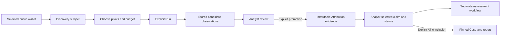
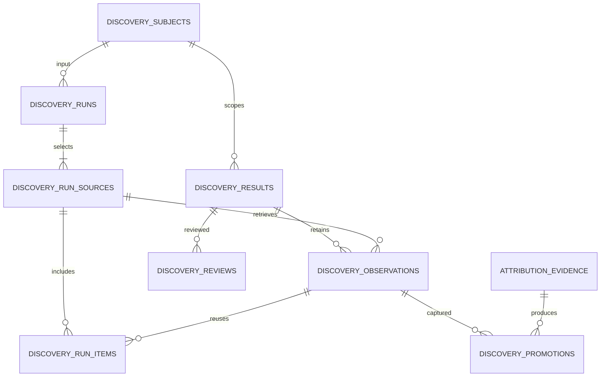

# OSINT Evidence Discovery / Pivot Engine

ED-9B clarification (2026-09-22): [EVIDENCE_DISCOVERY_ED9B.md](EVIDENCE_DISCOVERY_ED9B.md) activates `blockchain_address --publicly_labeled_as--> annotation(graphsense)`. The annotation value is the published label; source path and pointer remain part of result identity. Revision `20260922_02`, parent `20260922_01`, widens only the predicate CHECK. Graph presentation uses distinct `public_annotation` nodes. These are third-party public annotations, never local Labels, verified ownership or wallet clustering.

ED-9A clarification (2026-09-22): [EVIDENCE_DISCOVERY_ED9A.md](EVIDENCE_DISCOVERY_ED9A.md) implements explicit manual source capture. Revision `20260922_01`, parent `20260916_01`, adds only the Result predicate CHECK value `mentions_wallet`; the active pairs are `url -> blockchain_address` and `annotation(manual-source) -> blockchain_address`. The direction is source to wallet even for wallet-root investigations. The capture-only action `wallet.manual_source_observation` is Manual / FREE_LOCAL with zero network requests; exact-web remains navigation only. Existing run/result/immutable-observation/review infrastructure is reused. Preview writes nothing; confirmation is atomic and idempotent for exact material. Source aliases are provenance, not Entities. Graph `source_page` nodes preserve literal mentions without common-control inference. Reviewed material uses ED-6 with `analyst_added` origin. Optional existing Case references are explicit; attachments are reference/hash-only. No source fetch, Tor, automatic Attribution/risk/monitoring or user-database migration is introduced. Earlier roadmap and phase notes below retain their historical meaning.

ED-8A0 type-system clarification (2026-09-16): [EVIDENCE_DISCOVERY_ED8A0.md](EVIDENCE_DISCOVERY_ED8A0.md) adds the output-only `ens_name` subject kind, scoped to namespace `ethereum` (the current Mainnet scope), in revision `20260916_01`, parent `20260915_01`. The approved pair is `ens_name -> blockchain_address` with `resolves_to`, restricted to an Ethereum target. Wallet-root runs can retain that incoming relationship. Internal callers supply already canonical name values; this phase does not implement or claim ENSIP-15 normalization. ENS root inputs, resolution, executors, graph rendering and promotion remain deferred. Earlier roadmap references to ENS input support are not delivered capabilities.

ED-6 implementation clarification (2026-09-15): [EVIDENCE_DISCOVERY_ED6.md](EVIDENCE_DISCOVERY_ED6.md) documents the separately authorized explicit promotion workflow. Revision `20260915_01`, parent `20260913_01`, implements section 11.8 and the required `discovery_snapshot` evidence type/method and observation-origin FK. Relevant review authorizes the selected immutable material fingerprint; changed material requires its own review, while retained previously reviewed material remains selectable historically. Exact code excerpts permit explicit analyst-selected Supports, Contradicts or Context; unverified search context remains context-only. Promotion does not infer an entity/claim, change assessment or add risk. Earlier phase/status statements below remain historical.

ED-2 implementation note (2026-09-14): [EVIDENCE_DISCOVERY_ED2.md](EVIDENCE_DISCOVERY_ED2.md) documents the separately authorized execution/API framework. Head remains `20260913_01`; there is no schema change. The selected POST `/runs` create-and-execute/202 model, one-active-run single-process limit and guarded startup interruption recovery are implemented; production has zero executors. Malformed/oversized batches fail their source atomically, while valid incomplete coverage yields a partial run. All-unimplemented selections become unavailable sources and a failed run, with explicit not_implemented eligibility. Manual link generation remains ED-4. Quota accounts use operator-owned source generations independent of user selection; no automatic framework retry exists. Historical phase notes below retain their original scope.

ED-1 implementation note (2026-09-13): the separately authorized persistence/registry phase is documented in [EVIDENCE_DISCOVERY_ED1.md](EVIDENCE_DISCOVERY_ED1.md). Revision `20260913_01` follows `20260912_01` and adds the seven tables in sections 11.1-11.7. Attribution now verifies shipped revision ancestry as well as its existing schema/trigger/FK checks; startup excludes both migrated table families. The design-audit statements below describe the earlier document-only task.

ED-1 clarification: all three initial transforms remain unimplemented and non-executable. Local service commands record explicitly supplied, validated material without executing transforms. Only root run definitions are accepted; lineage columns reserve later explicit pivots. Observation, review and run-item rows have ORM and SQLite UPDATE/DELETE/REPLACE guards. Source accounting fields retain zero defaults and may hold sanitized quota context; reservation, charging, scheduling, cancellation workers and orphan-run recovery belong to the later executor. No Discovery HTTP/UI or promotion table is introduced.

Status: **proposed architecture; implementation is not authorized by this document**. Audit date: 2026-09-13. Repository: `C:\Tools\Inventions\greedy-collector`. Application baseline: **524 tests**. AT-1 through AT-6 are delivered in the inspected working tree, including uncommitted AT-6 files. Earlier phase documents describe their respective delivery dates; their statements that later phases do not exist are historical.

This task adds this document only. No engine, frontend, provider integration, dependency, migration, runtime record, or production behavior is added. The user's database is not inspected or migrated. Public documentation was consulted for provider constraints; no GC provider API, wallet query, source search using investigation identifiers, or source-content capture was executed.

## 1. Purpose

Find and organize public-source observations around an already selected public identifier: where an address appears, which sites or repositories cite it, which technical names resolve to it, and which further public identifiers merit explicit investigation. Results are **candidate evidence and candidate relationships**, with source, query, time, verification limits, and review history attached.

Recommend an address-first, analyst-driven first release. The useful outcome is a revisitable set of public clues, including disagreement, which the analyst can inspect and selectively promote into existing Attribution. Search hits do not identify a person, establish control, or change risk.

## 2. Non-goals

No automatic entity or claim creation, automatic assessment, risk scoring, Label creation, case population, alerts, recursive counterparty crawling, clustering, generic identity resolution, ownership inference, or name-to-hidden-wallet discovery. No private KYC acquisition, leaked credentials, private login/financial/ISP records, covert IP/device tracking, private-person bulk hunting, or private repository ingestion.

No free-form executable transforms, arbitrary HTTP proxy, browser automation that defeats source restrictions, LLM interpretation, third-party plugin marketplace, Neo4j requirement, or frontend framework. Public advertising/library and website tracking-code pivots are extension possibilities only; they exclude personal advertising/device identifiers and covert collection.

Discovery does not promise complete web, blockchain, repository, historical, legal-record, or identity coverage. Absence of results is not evidence that a relationship does not exist.

## 3. Terminology

| Term | Meaning |
| --- | --- |
| Subject | Typed, canonical identifier selected as pivot input; independent of a balance-bearing GC Address row |
| Transform / pivot | Registered, versioned operation with a closed input/output contract and bounded query semantics |
| Source adapter | Provider-specific transport and normalization behind that contract |
| Run | Durable record of one explicit analyst execution against one subject and selected transform/source pairs |
| Run source | One selected transform/source execution, including budget, status, cache decision and request accounting |
| Result | Stable, subject-scoped candidate fact/identifier/relationship grouping; not an AttributionEvidence row |
| Observation | Append-only sanitized material returned or captured at a specific time, with its provider/run provenance |
| Review | Analyst relevance decision about the material seen; not a truth or claim-strength assessment |
| Promotion | Explicit atomic capture of one reviewed observation into Attribution and attachment to an existing claim |
| Technical verification | A narrowly named check, such as full identifier in returned text or forward-confirmed ENS binding; not civil identity verification |

## 4. Current-state audit

Read completely: [Attribution architecture](ATTRIBUTION_ARCHITECTURE.md), [AT-1](ATTRIBUTION_AT1.md), [AT-2](ATTRIBUTION_AT2.md), [AT-3](ATTRIBUTION_AT3.md), [AT-4](ATTRIBUTION_AT4.md), [AT-5](ATTRIBUTION_AT5.md), and [AT-6](ATTRIBUTION_AT6.md). Inspected the following actual code, rather than treating older roadmap statements as current functionality.

| Area / code | Delivered behavior | Reuse and boundary for Discovery |
| --- | --- | --- |
| [Resolver](../greedy_collector/resolver.py), [chain base](../greedy_collector/chains/base.py), [subject normalization](../greedy_collector/attribution/domain.py) | Local BTC/ETH address/transaction syntax dispatch; transaction patterns precede permissive address regexes. Attribution canonicalization lowercases ETH/accepted bc1, preserves BTC Base58 case | Reuse validators and canonical subject utility. Format acceptance does not verify checksum, on-chain existence or control. Do not reuse graph-wide lowercase keys |
| [Wallet service](../greedy_collector/services.py): lookup_address / lookup_transaction; [Wallet UI](../static/js/wallet.js) | Address lookup retrieves real provider activity, persists address/transfers/risk; transaction lookup returns one normalized record without persisting it. Unified UI dispatches through resolver | Opening Discovery must not invoke either lookup. Existing bounded history is not an OSINT search index |
| [Blockchain adapters](../greedy_collector/chains/) | Bitcoin uses Blockstream/Mempool.space; Ethereum uses Etherscan with optional Alchemy balance fallback | No explorer-label, ENS, repository or generic web-search adapter exists. An Etherscan key does not imply metadata entitlement. Do not modify adapter pagination/fallback/transport |
| [Graph service](../greedy_collector/services.py): address_graph; [GraphStore](../greedy_collector/graph.py), [layout](../static/js/graph_layout.js) | Stored transaction traversal, hops 1-3, deterministic UI, optional Neo4j mirror. Backend can collapse transfers sharing a tx hash and folds address case | Discovery uses independent subject/result IDs and graph responses. Do not infer OSINT identity from collapsed transaction keys or repair graph behavior in this design |
| [AT-4 summary](../static/js/attribution_summary.js), [overlay](../static/js/attribution_overlay.js) | Local summaries; explicit selected-wallet/current-page attribution overlay, distinct entity nodes/claim edges; review/archive/rejection safeguards | Reuse navigation/detail patterns, not overlay edges as discovery findings. Discovery mode remains separate from both transaction and attribution layers |
| [Labels model](../greedy_collector/models.py): Label; [Labels UI](../static/js/labels.js) | Manual/CSV stored annotations, unique chain/address/label/source, timestamp/confidence; chain may be `any` | Explicit local exact-address pivot can snapshot annotations. Local confidence remains annotation metadata; never evidence of authentic publisher identity or a risk input created by Discovery |
| [Research catalog](../greedy_collector/kyc/sources.py), [engine](../greedy_collector/kyc/engine.py) | 25 descriptors: seven automated adapters and 18 manual links. screen() always selects four name adapters and adds three domain adapters when a domain exists | Reuse source IDs and implementations, but do not call whole screen() for a selected pivot. Catalog alone is not a selectable execution registry |
| Research inputs/results | OpenSanctions, INTERPOL, SEC ticker-name matching, GDELT use name; crt.sh, URLScan, VirusTotal use domain. KycQuery requires name. Other stored identity fields are not used by current matching | Never put a wallet in name or fabricate a name for a domain-only call. SEC is ticker-registry similarity, not filing-text/wallet search. Match score is text similarity, not attribution confidence |
| [Research persistence](../greedy_collector/services.py): kyc_screen; KycScreeningRun / KycMatch in [models](../greedy_collector/models.py) | Stores query/source statuses/matches; review status changes in place. API exposes sources, screen, match review, but no run-history list/detail | Discovery needs its own browsable run and observation history. Existing Research run/match snapshots remain available by known IDs through AT-5; do not invent previous-run UI availability |
| [Research presentation](../greedy_collector/kyc/presentation.py) | Configured credential booleans, source failure accounting and sanitization | Reuse safe patterns. Existing `_request` follows redirects and has no general SSRF/size guard; it is not a safe arbitrary-page fetcher |
| [Attribution models](../greedy_collector/models.py), [services](../greedy_collector/attribution/service.py), [API](../greedy_collector/attribution/router.py) | Five migrated tables, immutable evidence/events, optimistic versions, transactional links, supports/contradicts/context, explicit assessment, local actor | Discovery observations must stay separate. Promotion can reuse the capture/link/event machinery, not bypass it or manipulate assessment fields |
| [AT-5 handoff](../greedy_collector/attribution/handoff.py) | Server-read Label/Research previews, sanitized fingerprints, atomic versioned capture/link, safe duplicates and immutable provenance | Reuse preview-confirm semantics. Existing methods/types/CHECK constraints accept only analyst_entry, label_snapshot, research_snapshot. Discovery requires a separately reviewed schema/service extension in ED-6 |
| [AT-6 case service](../greedy_collector/attribution/cases.py), [report material](../greedy_collector/attribution/reporting.py), [report formats](../greedy_collector/reporting.py) | Explicit entity/claim pins using CaseEntity JSON; evidence IDs point to immutable captures; current vs pinned history; Markdown/HTML/JSON/PDF | V1 cases use promoted claim evidence through AT-6. New evidence does not alter an old case pin. Duplicate case references preserve first pin; no repin, removal API or stored report archive exists |
| [Database](../greedy_collector/database.py), [configuration](../greedy_collector/config.py), [routes](../greedy_collector/router.py) | SQLite/SQLAlchemy/FKs; `.env` loaded before settings; Alembic head 20260912_01. Legacy startup excludes only attribution_ tables from create_all; Attribution has a schema/trigger guard | ED-1 must also exclude discovery_ tables from legacy auto-creation and guard migrations. No automatic migration; no model registration that accidentally creates new tables on the real database |
| [Navigation](../static/js/app.js), [case handoff](../static/js/case_actions.js), [evidence handoff](../static/js/attribution_handoff.js) | Eight workspaces, vanilla modules, same-origin requests, explicit navigation/events and ID-based commands | Add future Discovery as a ninth workspace, preserving existing state; selecting/opening a node only reads local data |
| Risk, monitoring, alerts, tests | Separate deterministic risk and monitoring workflows; pytest/TestClient and isolated Node/Chromium harnesses | No discovery dependency in these mutation paths. All synthetic observations/providers stay under tests |

**Research reuse decision:** for existing stored matches, reuse AT-5 directly with the real match ID. For future explicitly selected remote Research transforms, expose a narrow source-dispatch facade in the existing Research module during ED-7, reusing its actual adapter method and normalizer. Preserve screen() behavior and cover it with regression tests. Discovery wraps only the selected source's output, preserves source limits/status, and does not create synthetic KycMatch rows just to make promotion work. No router switch containing copied HTTP integrations. No facade is implemented now.

**Additional migration compatibility finding:** AttributionService currently requires literal revision `20260912_01` in `alembic_version`, exact model column sets and exact immutability trigger definitions. An otherwise additive successor migration would change Alembic's head row and therefore make that revision check reject Attribution. ED-1 must include a narrowly tested compatible-descendant revision check, while retaining schema/trigger/FK verification; do not accept an arbitrary newer-looking revision string or disable the guard. This is a proven code-path integration constraint, not a request to change the service during this design task.

## 5. Subject types and exact matching

### Scope and canonicalization

**First release accepts `blockchain_address` as run input, with `bitcoin` or `ethereum` chain.** URL/repository/domain values can be output subjects and graph nodes without having executable transforms. This is extensible typing, not a promise to execute every type.

| Type | Initial handling | Canonical identity |
| --- | --- | --- |
| blockchain_address | V1 executable input and output | Chain + AT-1 normalize_subject result; no Address FK or lookup side effect |
| url | V1 output/citation; later controlled-fetch input | HTTP(S) conservative normalized locator; section 13; never fetch during resolution |
| repository | V1 code-search output | Provider + stable repository ID; path/blob/commit belong to observation citation |
| domain | V1 extracted output only; ED-7 input | ASCII IDNA hostname, lowercase, trailing dot removed; preserve display spelling; no DNS request merely to classify |
| transaction_hash | Recognizable using existing resolver but no V1 discovery execution | Chain + lowercase exact tx syntax. UI offers existing Wallet transaction lookup explicitly |
| ens_name | ED-7 output/input, Ethereum mainnet first | ENS-specific normalization and network namespace; do not substitute generic lowercase/IDNA for ENS normalization |
| entity | Later explicit selection of an existing AttributionEntity, not free-text person lookup | Local entity UUID, descriptor/version snapshot; names never merge IDs |
| public handle, document, tracking_id, advertiser, creative, campaign | Reserved future typed contracts, not accepted by initial API | Provider/network namespace + exact source ID; identifiers are not global people identities |

Normalize only outer safe whitespace. Reject embedded controls, zero-width characters and malformed typed inputs; never remove internal characters to manufacture an address match. Unknown and recognized-but-unsupported inputs get distinct safe errors and no remote request. Do not retain arbitrary rejected text or echo it in logs/errors.

### Full identifier checks

Generate query terms from validated subjects, not raw user text: quoted full address, escaped by the adapter and URL-encoded as a parameter. A quotation request is search intent, not proof that a provider performed literal matching. No fuzzy wallet search, prefix expansion or truncation matching.

For each returned title/snippet/record, locally tokenize complete address candidates and compare canonical chain-qualified values. Ethereum comparison is case-insensitive hex while preserving observed spelling; BTC Base58 comparison is case-sensitive; accepted bc1 normalization follows AT-1. Require boundaries so an address is not accepted as a substring of a longer identifier. Percent/HTML decoding is limited to the documented field encoding and recorded; never concatenate separated/truncated fragments, OCR guesses or confusable characters into a purported exact hit.

Verification vocabulary: `not_checked`, `exact_in_excerpt`, `exact_in_document`, `technical_verified`, `mismatch`, `not_applicable`. Every exact status names the field, full matched token and byte/character offsets or record locator. `exact_in_excerpt` proves only occurrence in the returned excerpt. A snippet hit is never relabeled `verified_page_observation`. A truncated `0x123...abcd` remains unverified even when the URL is promising. Hash-like identifiers in code may be fixtures, examples or test contracts; exact syntax says nothing about actual use.

## 6. Pivot / transform model

Registry entry: `id`, `version`, `display_name`, description, input schema/type/network, parameter schema, allowed result kinds/predicates/output types, compatible source IDs, matching-policy version, execution mode, cost class, request/result/byte/deadline limits, cache policy, capability requirements, and data-retention/promotion eligibility.

Conceptual interface (specification only): `validate(subject, parameters) -> ValidatedInput`; `plan(input, source_capability) -> BoundedPlan`; `execute(input, context) -> Batch[ObservationDraft] + Coverage`. Context owns the approved transport, quota reservation, cancellation, source configuration and clock. The adapter cannot insert evidence, call wallet lookup, create entities or start another transform.

A run may select at most three registered transform/source pairs initially. One logical transform can have multiple providers, selected explicitly; failure never silently falls back to a different paid provider. Local result normalization and graph projection are not additional remote pivots. New node selection is never execution.

## 7. Source / provider model and source classes

Sources are versioned Python descriptors, not user-defined URL templates stored in the database. Fields: source ID/name/category, automated/manual/local mode, transform IDs, supported input types, credential-required/configured flags, unavailable reason, cost class, rate-limit bucket/units, maximum fan-out, query semantics, expected evidence fields, provenance limitations, retention policy ID/version, storage/export permission, allowed endpoint origins and public-only restriction. Freeze safe descriptors in run-source records so later catalog changes do not rewrite history.

Cost classes: `FREE_LOCAL`, `FREE_REMOTE`, `LIMITED_FREE`, `PAID`. Separately show account/key requirements, remaining quota if known, and `unknown` when not measurable. Free remote work still discloses a query and consumes service capacity. Configured does not mean reachable, licensed or within quota; capability GET must not probe providers.

| Source class | Proposed treatment and evidentiary meaning | Initial disposition |
| --- | --- | --- |
| A. Blockchain/public explorers | Exact annotation text, explorer/record ID, chain/address, public URL, retrieval/source-update times. A generic address page is just a navigation destination, not a discovered label | Manual navigation first; metadata API only with verified entitlement; never upgrade to attribution automatically |
| B. Public web search | Full-address quoted query; retain provider, URL/title/snippet, returned rank, field-level match check and coverage | Manual first; optional official API only after storage rights and quotas are approved |
| C. Public code/repositories | Exact public code search; repository ID/name, public flag, file path, blob SHA, commit when actually available, contextual fragment and permalink | First automated external transform; public-only authenticated GitHub design |
| D. Name service | Reverse name, forward result, chain/network/block reference and validation outcome | ENS mainnet in later phase, not identity matching |
| E. Domain/infrastructure | RDAP, CT, DNS, existing URLScan/VT observations, archives and later public site tracking-code references | Follow a selected domain explicitly; no shared-infrastructure ownership inference |
| F. Government/legal/public records | Issuer, jurisdiction, case/document identifier, publication/observation time and exact passage; designation, allegation and judgment distinguished | Existing manual/Research routes; no automatic private-person name hunting |
| G. Existing GC Research | Seven actual adapters and 18 manual catalog links, preserving their original query/score/status semantics | Stored ID handoff now reusable conceptually; selected-source remote facade deferred |
| H. Existing GC Labels | Exact chain/address local stored annotation, original source/confidence/date and Label ID | First local transform; explicitly secondary analyst annotation, not a new public-source collection |

### Web search options

| Option | Practical advantages | Constraint / recommendation |
| --- | --- | --- |
| Official full-web API, e.g. Brave Search | Documented structured results, account quotas, no GC scraping of search HTML | Account/key and usage limits; storage rights are essential for this architecture. Brave's help page restricts default retention and its product page calls for an explicitly storage-authorized plan. Do not enable retained Discovery results on trial credits alone. [Brave API help](https://api-dashboard.search.brave.com/documentation/resources/help-feedback), [storage rights](https://brave.com/search/api/) |
| Google Custom Search JSON API | Documented JSON protocol for existing customers | Closed to new customers, with existing customers directed to transition by January 1, 2027. Do not choose it as a new GC dependency or advertise its old free allowance as generally available. [Google documentation](https://developers.google.com/custom-search/v1/overview) |
| Privacy-oriented hosted search/metasearch | May reduce direct dependence on one index; browser/manual use remains possible | Privacy branding does not establish API access, full-web coverage, storage rights or anonymity from the upstream operator. Require documented API terms and provenance before adapter selection; no unofficial HTML scraping fallback |
| Self-hosted SearXNG | Operator-controlled interface; JSON search API when enabled | Hosting/maintenance cost; upstream engines still impose access/retention limits. Public instances may disable JSON. Record both metasearch instance and returned engines; do not assume self-hosting grants upstream rights or hides queries from them. [SearXNG API](https://docs.searxng.org/dev/search_api.html) |
| Browser/manual fallback | No GC remote request or API key; preserves access to sources without supported APIs | Produces navigation instructions only. Opening a link is an external user action; no fabricated run success/result count. Capturing a real citation is a separate analyst action |

Recommendation: keep generic search provider-neutral and manual in the first release. Add one storage-authorized official API later rather than quietly scrape Google or depend on a public metasearch instance. Do not add an answer-generation API where citations and snippets are required. Commercial price points are deliberately not frozen here.

### Specific later-source constraints

GitHub's code-search documentation states authentication and a separate 10-request/minute code-search limit, default-branch/file-size restrictions, and possible incomplete results. Its fine-grained-token paragraph also contains a conflicting public-resource unauthenticated statement. GC should require a configured least-privilege token and verify current endpoint behavior during a separately authorized integration test; it must not promise keyless code search. Preserve `incomplete_results` and public-repository checks. A blob SHA is not necessarily a commit SHA. Search does not cover all history or all files. [GitHub Search API](https://docs.github.com/en/rest/search/search#search-code)

ENS reverse records must be forward-checked against the original address. Proposed mainnet observation includes network/coin type, reverse resolver, forward resolver, returned name/address, and a common block number/hash where supported. Mismatch is retained, not presented as a verified primary name. No name means no observed binding, not no identity. Off-chain CCIP-read requires separate controlled-fetch treatment; never let a resolver cause arbitrary HTTP requests implicitly. No gas transaction/signing is needed for read-only observation. [ENS primary-name guidance](https://docs.ens.domains/web/reverse/)

Etherscan's address metadata endpoint is documented as Pro Plus, with its own throttle. Ordinary wallet lookup credentials do not authorize this source. Only public nametag/label fields are eligible; do not persist internal notes or infer reliability from provider reputation numbers. Bitcoin balance/history endpoints likewise must not be described as label feeds merely because they expose address pages. [Etherscan address metadata](https://docs.etherscan.io/api-reference/endpoint/getaddresstag)

Domain source adapters must distinguish registrar from registrant, privacy proxy from disclosed organization, certificate SAN from site ownership, historical DNS from present resolution, and a public scan from current content. Reuse existing crt.sh/URLScan/VT code at the selected-source boundary. URLScan is search of existing public observations, never submission of a new scan. Respect endpoint-specific quotas/backoff. VirusTotal public API has usage restrictions beyond the existence of a free key; commercial use requires the appropriate entitlement. [URLScan API](https://urlscan.io/docs/api/), [VirusTotal public versus premium](https://docs.virustotal.com/reference/public-vs-premium-api)

Archive support begins from a known URL, not a promise to search historical page text for any wallet. A later Wayback CDX transform returns capture index records; a separate safe content observation must actually verify the wallet passage. Preserve original URL, replay URL, archive provider, capture timestamp, MIME/status/digest and GC retrieval time. Redirect/error captures are not successful historical page evidence. Other archives, including Common Crawl, require their own availability, retention and extraction assessment. [Internet Archive CDX design](https://github.com/internetarchive/wayback/tree/master/wayback-cdx-server)

## 8. Discovery result and observation model

Separate stable grouping from time-specific material. A `DiscoveryResult` has an input subject, `candidate_evidence` / `candidate_identifier` / `candidate_relationship` kind, output subject where applicable, bounded predicate, normalized fact key and analyst review revision. It does not contain a mutable replacement for evidence content.

Each result can have many immutable `DiscoveryObservation` rows: provider ID and descriptor snapshot, execution ID, source locator, observation kind, title, concise excerpt/context, returned field match/verification, source timestamps, retrieval timestamp, sanitized minimal provider fields and content fingerprint. Multiple engines finding one URL retain separate observations and independent provenance. Repeated retrieval of the same content records a new retrieval observation; a cache replay references the old one.

Observation kinds: `search_result`, `code_search_result`, `local_label_snapshot`; later `verified_page_observation`, `explorer_annotation`, `name_service_record`, `research_result`, `archive_index_record`, `analyst_capture`. A provider result is never silently escalated to another kind.

Source category describes origin (claimed official disclosure, legal record, explorer annotation, independent reporting, user-generated content, unknown). Default reliability is `unassessed`; analyst choices reuse reliable/uncertain/unreliable with a reason when promoted. Matching quality, provenance completeness, publisher class, time/freshness, and source reliability are separate named fields, not one numeric confidence. A hostname alone never earns an official/reliable badge.

Retain conflicts as different candidate facts: exact label text and the issuing source belong in annotation fact keys; a later different label does not overwrite the earlier assertion. Display disagreement without selecting a winner. Do not count copied articles, mirrored repositories or two search engines returning one page as independent corroboration.

## 9. Candidate relationship vocabulary

| Predicate / direction | Meaning and eligible observation | Does not mean |
| --- | --- | --- |
| mentioned_at: address -> URL/document | Candidate mention, with verification badge; exact only if full token verified in the stated material | Publisher operates the wallet; snippet equals page contents |
| repository_contains: repository -> address | Returned public file/excerpt contains full address, with file citation | Repository owner controls it; file is production configuration |
| explorer_labeled_as: address -> source-scoped annotation identifier | Exact public label reported by a named explorer | Label is an Entity or confirmed attribution |
| locally_labeled_as: address -> Label reference identifier | GC secondary annotation snapshot | New external corroboration |
| publicly_listed_by: address -> cited document/URL | A cited listing, with exact source passage and explicit verification level | Existing Attribution publicly_declared_by claim has been established |
| reverse_name_record: address -> ENS name | Observed reverse response, including failed forward verification | Verified primary name without forward match |
| resolves_to: ENS name -> address; later domain -> network identifier | Scoped technical record at a time; forward/record checks declared | Civil identity or common legal ownership |
| registration_record_for: domain -> public record | RDAP/registration record exists | Registrar/privacy proxy is beneficial owner; no generic registered_to edge |
| certificate_names: certificate/document -> domain | Recorded certificate name | Site operation or exclusive infrastructure |
| observed_at: domain -> public scan observation | Existing public observation, time-qualified | Current site state or new scan |
| archived_at: URL -> archive capture | Indexed historical capture; content verification separate | Wallet present in that page until checked |
| uses_tracking_id: site/domain -> namespaced public site code | Later publicly visible pixel/tag ID observation | Same personal user/device, common owner or covert tracking |
| advertises_at: public advertiser/creative -> landing domain | Later source-reported ad-library relationship | All involved pages belong to one actor |

Do not store unrestricted predicates supplied by a provider/browser. Registry validation checks subject/object type combinations. Same tracking ID can be displayed through two `uses_tracking_id` edges to one typed node; no inferred ownership edge or automatic pairwise domain clique is required. `official_domain_of` and `registered_to` are deferred rather than implying facts the current sources cannot establish. No attribution relationship is automatically emitted as a claim.

## 10. Selected relational data model

| Option | Tables and query pattern | Advantages | Costs / limits |
| --- | --- | --- | --- |
| A. Run-owned result snapshots | runs, run_sources, run_results with JSON material, reviews and promotion references; no shared result identity | Few joins; one run naturally retains its material; suitable for a disposable search screen | Repeated copies of the same URL/fact; relevance decisions need cross-run fingerprint searches; provenance aggregation and graph identity become ad hoc; caching risks copying new retrieval timestamps onto old data |
| B. Stable subjects/results plus immutable observations (selected) | subjects, runs, run_sources, results, observations, run_items, reviews; promotions added at ED-6 | Cross-source grouping without lost observations; persistent false-positive review; explicit cache replay; pinned promotion provenance; normal indexed SQLite joins | More explicit identity rules and joins; must distinguish global current review from historical run material. Bounded paging and batched reads required |

Select B. **Seven Discovery tables in ED-1; an eighth, promotions, and a focused Attribution schema extension in ED-6.** No independent edges table: result rows contain typed edge endpoints and predicates, while observations contain the source justification. No cache table initially: completed run-source executions plus their run_items form the cacheable result set, indexed by query fingerprint. Source/transform definitions remain in code, with immutable safe run snapshots instead of mutable catalog FKs.

This diagram omits secondary endpoint/self-reference FKs for readability; the following definitions are authoritative. SQLite is sufficient for bounded joins and graph projection; no graph database or full-text service is required. No network work occurs inside a database write transaction.

## 11. Proposed tables, constraints and lifecycle

**Specification only, not DDL or a migration.** Use existing UUID String(36) IDs and UTC timestamps. Notation: ID=String(36), S(n)=String(n), T=Text, DT=DateTime(timezone=True), D=Date, J=JSON, I=Integer. Every column is NOT NULL unless marked `?`; defaults are explicit below, otherwise assigned by the server. Every FK is `ON DELETE RESTRICT`, IDs never change. Each indexed FK is listed. All named enum, nonnegative count, JSON-shape/size and type-pair invariants require Pydantic/service validation; SQLite CHECKs enforce feasible scalar invariants. VARCHAR length alone is not an SQLite bound.

All timestamps serialize with existing UTC ISO-8601 conventions; unknowns remain null. Source dates at day precision use D and are not invented midnight instants. JSON snapshots use finite, deterministic canonical JSON, max depth 32; bounded snapshot object size initially 16 KiB so a selected capture can fit Attribution's 32 KiB metadata limit. Title max 255, excerpt/summary max 4,000 each; oversized semantic material fails explicitly or is a deliberately bounded excerpt with `excerpt_complete=false`, never silently a complete-document claim.

### 11.1 discovery_subjects

Columns: `id ID PK`; `kind S(32)`; `namespace S(128)`; `canonical_value T` (max 2048); `display_value T` (max 2048); `normalization_version I=1`; `identity_sha256 S(64)`; `created_at DT=utcnow()`.

UNIQUE(identity_sha256), INDEX(kind,namespace,id). Identity hashes canonical JSON of kind/namespace/value; after hash match compare those actual values and reject a collision rather than merge. No nullable chain uniqueness: namespace is required, e.g. bitcoin/ethereum, https, github, gc-label. API exposes chain for blockchain subjects, mapped to namespace. No FK to addresses. `annotation` is a permitted output-only kind with source-scoped identifier; it is not AttributionEntity. Store only validated types needed by enabled transforms; reserved future types require later contract/migration review before acceptance. Immutable identity/display-on-creation; later source titles belong to observations, not renamed subjects. No deletion API.

### 11.2 discovery_runs

Columns: `id ID PK`; `subject_id ID FK subjects.id`; `parent_observation_id ID? FK observations.id`; `root_run_id ID? FK discovery_runs.id` (null for root); `lineage_depth I=0`; `idempotency_key S(128)`; `request_sha256 S(64)`; `request_snapshot J` (schema_version, normalized public subject, selected transform/source/version/parameters, explicit limits and cache mode); `actor_ref S(128)='local_analyst'`; `status S(24)='queued'`; `created_at DT=utcnow()`; `started_at DT?`; `completed_at DT?`; `deadline_at DT`; `cancel_requested_at DT?`; `archived_at DT?`; `version I=1`.

UNIQUE(idempotency_key); INDEX(subject_id,created_at,id), INDEX(status,created_at,id), INDEX(root_run_id,created_at,id), INDEX(parent_observation_id). Allowed statuses in section 15. CHECK lineage_depth>=0; root has both parent/root null and depth0; child has both present and positive depth. Service verifies parent was already committed and input is an explicit selected output from it, derives root/depth, and forbids cycles or retargeting. No arbitrary root lineage supplied by client. Request snapshot/subject/lineage are immutable; only lifecycle fields/version change. Time ordering checked when values exist. Archive affects default browsing, not results/evidence or remote jobs; archive only terminal runs. No hard delete or destructive cascade.

### 11.3 discovery_run_sources

Columns: `id ID PK`; `run_id ID FK runs.id`; `ordinal I`; `transform_id S(128)`; `transform_version I`; `source_id S(128)`; `source_version I`; `config_generation S(64)` (nonsecret administrator version); `descriptor_snapshot J`; `parameters J`; `query_fingerprint S(64)`; `cache_from_id ID? FK discovery_run_sources.id`; `status S(24)='queued'`; `started_at DT?`; `completed_at DT?`; `expires_at DT?`; `retention_policy_id S(128)`; `coverage S(24)='unknown'`; `provider_total I?`; `returned_count I=0`; `requests_reserved I=0`; `requests_attempted I=0`; `cost_unit S(32)`; `units_reserved I=0`; `units_consumed I=0`; `quota_bucket S(128)`; `quota_window_start DT`; `quota_snapshot J={}`; `attempt_log J=[]`; `error_code S(64)?`; `retry_after_at DT?`.

UNIQUE(run_id,ordinal), UNIQUE(run_id,transform_id,source_id); INDEX(query_fingerprint,status,expires_at,completed_at), INDEX(quota_bucket,quota_window_start,status), INDEX(cache_from_id). Strictly nonnegative counts and positive ordinal/version. Null provider_total means unknown, never inferred from returned_count. Coverage: `bounded`, `provider_incomplete`, `limit_reached`, `unknown`; a successful empty result is still bounded coverage. Attempt log is sanitized, max 12 entries, with timestamp/outcome/request class/charged units only, not request URLs/headers/bodies. Cache hit points directly to a successful original non-cache execution, never a chain. Same query/config/version/retention profile required. Cache hit and manual-ready have zero remote attempts and consumed units. Remote/local/manual/cache mode is frozen in descriptor plus final status. Terminal records remain immutable; retries use a new run.

### 11.4 discovery_results

Columns: `id ID PK`; `query_subject_id ID FK subjects.id`; `kind S(32)`; `predicate S(64)`; `from_subject_id ID FK subjects.id`; `to_subject_id ID? FK subjects.id`; `fact_key J`; `identity_sha256 S(64)`; `first_seen_at DT`; `last_seen_at DT`; `material_revision I=1`; `review_status S(16)='unreviewed'`; `reviewed_material_revision I=0`; `version I=1`.

UNIQUE(identity_sha256); INDEX(query_subject_id,last_seen_at,id), INDEX(from_subject_id,predicate,id), INDEX(to_subject_id,predicate,id), INDEX(review_status,last_seen_at,id). Result kind CHECK candidate_evidence/candidate_identifier/candidate_relationship; predicate/type-pair validated by registry. Identity includes query subject, direction/endpoints/predicate and normalized fact key; compare fields on hash hit. Same source location returned under different wallet queries remains separate review scope. A repository_contains result can point repository -> wallet while its query subject remains the wallet.

Identity/fact fields are immutable. Changed annotation assertion creates another result; changed contents behind an unchanged URL create new observations under the same result. first/last_seen refer to genuine retrievals, not cache replays. material_revision increments for a previously unseen content fingerprint; version advances on ingestion/review under optimistic checks. An index of observations supports this without treating every refresh as new evidence. Reviewed_material_revision cannot exceed material_revision. `review_status` is the latest explicit decision, with a derived `new_material_since_review` flag; it is not automatically overwritten on refresh.

### 11.5 discovery_observations

Columns: `id ID PK`; `result_id ID FK results.id`; `execution_id ID FK run_sources.id`; `source_record_key S(512)`; `kind S(40)`; `source_url T?` (max2048); `source_locator S(512)?`; `title S(255)`; `summary T`; `excerpt T?`; `excerpt_complete Boolean=false`; `verification S(32)`; `match_context J={}`; `source_class S(40)='unknown'`; `observed_at DT?`; `observed_on D?`; `published_at DT?`; `published_on D?`; `retrieved_at DT`; `source_snapshot J`; `content_sha256 S(64)`; `origin_label_id ID? FK labels.id`; `origin_match_id ID? FK kyc_matches.id`; `created_at DT=utcnow()`.

UNIQUE(execution_id,result_id,source_record_key,content_sha256); INDEX(result_id,retrieved_at,id), INDEX(result_id,content_sha256), INDEX(origin_label_id), INDEX(origin_match_id). No global UNIQUE(content_sha256): equal material from different providers/times still has separate provenance. At most one Label/Research origin FK; local_label_snapshot requires label ID; snapshot of a real stored Research match requires match ID. A newly executed reused Research adapter returns discovery material, not a forged KycMatch FK. Source record key is adapter-derived, not a secret-bearing URL.

Require source URL or locator and typed verification context. CHECK not both observed_at and observed_on, and not both published_at and published_on. GC retrieval time is always present. Later verified_page_observation requires successful controlled-fetch facts and exact document match; browser input cannot set that kind. Immutable after insertion with ORM and future migration UPDATE/DELETE/replacement guards, as for Attribution. Raw provider dumps are not stored. The sanitized snapshot retains native source ID, public-only check, provider/issuer/record context, field precision and adapter/schema versions.

### 11.6 discovery_run_items

Columns: `run_source_id ID FK run_sources.id`; `observation_id ID FK observations.id`; `ordinal I`; `rank I?`; `included_at DT=utcnow()`; `inclusion_kind S(16)` (`retrieved`, `local`, `cache`). Composite PK(run_source_id,observation_id); UNIQUE(run_source_id,ordinal); INDEX(observation_id). Nonnegative rank when supplied; ordinal positive. Server verifies observation execution matches run_source for new retrieval/local, or matches the source cache_from_id inventory for cache replay. Never generate a new observation or later retrieved_at to represent cache use. Append-only rows retain each run's actual material and deterministic displayed ordering; provider rank is metadata, not confidence.

### 11.7 discovery_reviews

Columns: `id ID PK`; `result_id ID FK results.id`; `observation_id ID FK observations.id`; `sequence I`; `material_revision I`; `status S(16)` (`unreviewed`, `relevant`, `irrelevant`); `reason T` (nonblank, max4000); `actor_ref S(128)='local_analyst'`; `occurred_at DT=utcnow()`.

UNIQUE(result_id,sequence); INDEX(observation_id), INDEX(occurred_at,id). Service verifies selected observation belongs to result and reviewed revision is current at submission; expected result version and selected immutable observation fingerprint are required. Sequence is result-scoped review sequence, not result version (ingestion can also advance version). Append-only; decision + current result summary/version update commit atomically. Irrelevant is retained, not deletion. Reset to unreviewed requires an explicit reason. Promotion state is separate, so a result can later be judged irrelevant without erasing a prior capture.

### 11.8 discovery_promotions (ED-6 only)

Columns: `id ID PK`; `observation_id ID FK observations.id`; `claim_id ID FK attribution_claims.id`; `evidence_id ID FK attribution_evidence.id`; `link_id ID FK attribution_claim_evidence.id`; `source_fingerprint S(64)`; `capture_fingerprint S(64)`; `claim_version_before I`; `claim_version_after I`; `actor_ref S(128)='local_analyst'`; `created_at DT=utcnow()`.

UNIQUE(observation_id,claim_id); INDEX(claim_id,created_at,id), INDEX(evidence_id), INDEX(link_id). Service checks link points to this claim/evidence; one version advance matches normal capture/link semantics. Append-only, committed with capture/link/events. Repeat same observation/claim returns 409 with existing link/promotion IDs even if withdrawn; explicit restore/relevance change remains Attribution's action. Same observation for another claim may reuse the same immutable capture if its complete capture fingerprint matches; independence is never inferred.

### Schema deployment and retention

No migration file is created in this task. ED-1 future migration must be additive after the actual then-current head, presently 20260912_01; never modify prior revisions. Include named constraints/indexes and immutable row protections, schema guard, explicit metadata-only test setup, and the legacy startup exclusion for discovery_ tables. Update Attribution's revision check to recognize explicitly compatible descendants through the shipped migration graph plus schema/trigger verification; test both the existing AT head and the new reviewed ED head, and reject unknown/partial/incompatible states. Tests must prove no partial auto-created schema on an unmigrated database. A database with Discovery absent still supports existing workspaces; promotion separately requires the Attribution schema plus ED-6 extension.

Discovery history has no generic delete endpoint in V1. Archive hides terminal runs while preserving review, observations and promoted provenance. Expiring a cache only disables reuse; it never deletes evidence/history. Admit an automated provider only when its policy permits the designed retained normalized observations and future evidence export. A provider requiring short-lived deletion is unavailable to this retained V1 adapter, not silently cached forever. Future exceptional deletion/redaction needs a separate policy and provenance-preserving design; no claim of unlimited retention rights. Quota/cache metadata are operational state, not tamper-proof audit evidence.

## 12. Transform registry and extension boundary

Use an internal registry keyed by transform ID/version and a source-adapter registry keyed by stable provider ID. Registration fails on duplicate IDs, unsupported type/predicate combinations, missing limits, unsafe endpoint definitions, or absent retention policy. Registry declarations are application code reviewed with tests, never executable strings supplied through API/DB.

A new implementation supplies its typed validator/normalizer, adapter and fixture tests and is registered once. Central routes call the generic planner/executor; they do not contain a new branch per provider. Existing Research adapters remain in their module; a future thin facade exposes only explicitly named supported operations. No package loading from user paths, arbitrary import strings, scripts or user-authored URLs. Version adapter normalization, result identity, matching and policy; store those versions in each run descriptor.

Initial public capability output includes safe IDs, display text, input types, cost class, key_required, configured, enabled, unavailable_reason, configured cap/freshness and storage_allowed. No key, full RPC endpoint, credential-bearing URL, local path or probe result is returned. Proposed `.env` additions in implementation phases: `DISCOVERY_ENABLED` (default false), `DISCOVERY_GITHUB_TOKEN`, per-source enable flags/caps, an explicit nonsecret configuration generation and later a configured search/RPC source. Do not add these values or files now. Use existing config loading; extend configured-secret redaction to new credentials before enabling any provider.

## 13. Deduplication

Three identities serve different purposes:

1. **Query fingerprint:** canonical validated subject + transform/source versions + normalized parameters + limits/page scope/language + matching/policy version + nonsecret configuration generation. No timestamp, credential or hidden user input. Cache compatibility is exact.
2. **Result identity:** chain-qualified query subject + candidate kind + predicate + directed endpoint identities + normalized fact key. For web mentions, conservatively normalized URL; for code, stable repo ID/path/queried address, with actual blob/commit in observations; for explorer annotations, source and exact label/assertion; for local Labels, Label ID. Do not merge different annotation assertions into a winning label.
3. **Observation content fingerprint:** canonical sanitized material/citation/native reference/verification/source-time fields and provider namespace, excluding generated ID/GC retrieval time and operational quota/rank. Same-content refresh gets a new retrieval observation with the same fingerprint; within one execution exact duplicates collapse with all native locators preserved in the bounded snapshot. If locators cannot be retained within bounds, use separate observations rather than drop provenance.

URL normalization lowers scheme/IDNA host, removes default port and normalizes an empty path to `/`; it preserves meaningful path case, query parameters/order, encoding and fragments conservatively. Do not merge http/https, www/non-www, trailing path slashes, arbitrary reordered queries or redirected URLs without source-specific evidence. A fragment may identify a passage; retain it even if the fetch layer removes it from the wire request. Known tracking-only parameters can be removed only under a versioned source policy with the safe original retained. Credentials cause rejection/withholding, not a query URL retained under a different key. False merges are worse than a few duplicate cards.

Two search engines finding one safe normalized URL give one result with two observations/provider badges; no provenance disappears. Forks, mirrors and copied reporting remain separate cited observations, optionally marked as possible common origin for analyst review. No duplicate count becomes claim strength.

## 14. Caching and freshness

Planner reads the latest compatible terminal original run-source and its immutable inventory. Only successful eligible executions are cache candidates. Run-scoped failures, rate limits, malformed output, partial/incomplete coverage and manual instructions are not successful cache results. Successful bounded zero-result output may use a short negative TTL. Store cap/coverage even for successful cache entries so a bounded result is never called exhaustive.

Proposed operator defaults, **not provider promises**: local Labels re-read locally (no remote cache); exact code/web results up to 24 hours; successful zero results 1 hour; later ENS 15 minutes and source block recorded; explorer annotations 24 hours; future RDAP/DNS/CT/public-scan results use adapter-specific TTLs capped by source policy. An immutable commit citation remains historically useful after its cache expires; TTL is permission to avoid a new query, not truth expiration. Respect stricter provider cache directives/retention terms.

`Use cache` is default for an explicit Run; a cache hit creates a real run-source/cache inclusion record with zero remote cost and original retrieved_at. `Refresh source` is explicit, previews quota and creates another run; no background refresh or stale-while-revalidate traffic. An expired result remains visible marked historical/stale. A provider outage does not relabel old cached material as newly retrieved success. A provider/configuration/policy change invalidates cache compatibility without rewriting historical results.

Source observed_at/published_at may precede retrieval by years; source date-only values retain precision. GC cannot assert that material existed before its earliest substantiated observation. No replacement of historical content on a page change or disappearance. Cache identity and immutable Attribution capture identity stay separate.

## 15. Run execution and browsable history

V1 uses one bounded in-process executor owned by the FastAPI lifespan and persisted run state, with one application worker as the supported Discovery deployment. No Celery/Redis dependency or monitoring scheduler reuse. Multi-process/distributed execution requires a later persisted lease design; do not claim cross-worker exactly-once execution now.

POST validates all typed inputs and selected registered transforms locally, allocates run/run-source records and reserves the approved maximum source units in a short SQLite transaction, then returns 202. Unknown input or malformed transform has no remote effect. Unsupported key/entitlement remains a visible skipped source if other selections can run. Do not acquire a SQLite writer lock across await/network work.

Executor commits each source's accepted bounded results/observations/run_items and terminal status in one short transaction. A source failure leaves other successful sources intact. A malformed record can be rejected with a sanitized rejected-record count and provider_incomplete coverage while retaining valid records; never mark that batch complete. Overflow stops before exceeding agreed request/result/byte caps and records limit_reached. Persisted run results are paginated from SQL, not held only in a browser response.

Run states: `queued -> running -> completed | partial | failed | cancelled | interrupted`. `completed` means all selected operations reached their defined success, cache_hit or manual_ready outcome, not that the whole web was searched. `partial` means some useful completed material/instructions and some unsuccessful/skipped source work. `failed` means none succeeded. On cancel/deadline stop issuing new calls, retain already committed results and source statuses. In-flight cost may already have been charged. Cancellation is best effort, not a refund.

Run-source states: queued, running, succeeded, cache_hit, manual_ready, unavailable, rate_limited, budget_exhausted, timeout, failed, cancelled, interrupted. A source success with zero rows is distinct from unavailable. Status explains the source failure without embedding exceptions. On normal shutdown cancel/wait briefly for active operations, persist terminal markers, and close the worker. On restart mark orphaned queued/running work interrupted; **do not automatically replay paid requests**. Ambiguous interrupted attempts are conservatively counted as consumed until an administrator reconciles them.

Idempotency key identifies the submitted execution intent: same key and identical request returns the existing run; same key/different request returns 409. New explicit rerun uses a new key. No exactly-once promise across remote service and local commit; if response is lost or commit fails, record interrupted and require explicit rerun. Existing history GETs and selection make no provider calls.

History UI lists subject, selected pivots/sources, status, original retrieval times, cache usage, costs/coverage and result count. Run detail preserves the original observation inventory, even if current review or source state differs. A later selected child pivot records parent observation/root/depth; depth is analyst navigation lineage, not automatically traversed blockchain hops. No recursive execution in V1. Later depth-1/depth-2 automation requires a separate allowlisted plan, visited-set/cycle protection, cumulative budget and cancellation design.

## 16. Review workflow

Persist exact statuses **Unreviewed**, **Relevant**, **Irrelevant** (`unreviewed`, `relevant`, `irrelevant`). Show **Promoted to evidence** as a separate derived badge with capture/claim IDs. This avoids losing a relevance decision or implying that promotion is a positive assessment. A result can have captures in several claims with different stances.

Analyst opens a specific immutable observation, sees full identifier verification, source/excerpt limitations, dates and competing observations, then records relevance with a reason and expected result version. Reset/review corrections append history. An Irrelevant result is retained and omitted by the default attention filter when identical content reappears; counts and an Include irrelevant filter preserve access. New content marks `new_material_since_review` and resurfaces as changed material with the earlier decision shown, rather than silently resetting or permanently suppressing a changed clue. Repeated identical retrievals/cache use do not flag new material.

Manual pivot state is **Manual action available - not queried by Greedy Collector**. It generates a safe provider-specific link/instructions from the selected public identifier. No match/observation/evidence is invented for opening a link. An analyst who finds a citation can use the existing explicit manual Attribution capture workflow; a later dedicated Discovery analyst_capture feature would need source/time and clearly analyst-declared verification. V1 does not pretend to ingest browser activity.

## 17. Discovery graph

Recommend a **separate Discovery graph mode inside the future Discovery workspace**. Nodes are typed Discovery subjects with full identifier/citation access; candidates referring to names are annotation/text nodes, not newly created AttributionEntity rows. Edges are result IDs with literal predicate labels/verification badges and observation counts. Selecting an edge lists every included source observation and its time, not transaction amounts.

V1 graph is a projection of selected run results, no persistent duplicate graph model. Root at layer0; directly returned endpoints at layer1 grouped by kind/source. Later explicitly selected child runs add lineage layers. Sort groups and nodes by canonical type/identity, use fixed measured node/label bounds, stable sibling ordering and deterministic spacing. Typed cards, direction arrows, source detail, fit/pan/zoom and an explicit focus highlight can reuse graph interaction patterns without inheriting wallet-only key logic. No physics jitter, inferred ownership layout or scoring algorithm.

Combine identical predicate/from/to visual connections only while retaining their result/observation IDs in the inspector; different predicates or conflicting annotation values stay distinct. Repeated visits to the same subject share one namespaced node, never discard provenance. Proposed namespaces are `discovery:subject:<uuid>` and `discovery:result:<uuid>`. Logical graph direction is the defined predicate, not necessarily the direction in which the analyst executed a query.

A run starts bounded (three pairs, at most100 observations each). If combining child runs later exceeds200 visible nodes, default to explicit source/type groups with totals and expand controls; retain all returned rows in paginated tables and graph data. Clearly display visible/total counts. No silent pruning and no unrestricted recursive graph collection. Graph loading, selection, expand and fit query local stored data only. A new remote pivot requires selecting an eligible node and pressing Run.

## 18. Blockchain graph boundary and workspace handoffs

Blockchain Graph continues to show stored transfer relationships and its existing AT-4 optional claim overlay. Discovery edges never enter Transaction, GraphStore, Neo4j transaction mirrors, wallet counterparty lists, exposure paths or blockchain hop counts. Different endpoint/renderer/state scopes prevent a mentioned_at edge from appearing as a fund transfer. No Discovery overlay in the initial transaction graph; a later typed overlay would require separate legend, selection semantics and focused topology tests.

Future Wallet **Discover public evidence** and wallet-node **OSINT pivots** open Discovery with chain/address prefilled. Navigation may read local capabilities/history; it does not call resolver providers, lookup, Research screening or remote transforms. Source selection and explicit Run are still required. Returning retains the original wallet/graph viewport and selected node. Do not call existing `investigate()` as the prefill mechanism if it would perform a wallet lookup.

Case V1 recommendation: include Discovery material **only after explicit promotion to a claim and explicit AT-6 case inclusion**. Do not add discovery_run/result CaseEntity kinds, automatically append case notes, or infer cases from shared wallets. The promoted immutable capture retains discovery IDs so report provenance is useful. An already pinned Case does not gain newly linked evidence automatically; AT-6's first-pin/no-repin limit remains visible. Future direct run/result references and case repinning need a separate versioned case design.

## 19. Attribution promotion

### Workflow and atomicity

1. Select an actual stored observation and open a server-generated sanitized promotion preview. Review kind, excerpt/full-document distinction, match check, provenance, source time and retention eligibility. The server reads records by ID; browser copies are never authoritative.
2. Choose an existing claim via real paginated Attribution filters. If a new entity/claim is needed, navigate to the existing explicit forms and return; no suggested text creates a record. No V1 automatic entity suggestions.
3. Explicitly select supports/contradicts/context, directness and rationale. Neither stance nor directness defaults to a positive interpretation. Snippet-only/unverified search observations may be captured **as context with context directness only**, accurately titled search-result snapshot. A full passage or code/technical observation still requires an analyst to explain its actual relevance; exact matching alone cannot supply directness/reliability.
4. Confirm with selected observation ID, expected source fingerprint, target claim ID/version, link fields, and any explicitly reviewed capture description/reliability rationale. Subject compatibility is checked: wallet-root discoveries must match the claim chain and canonical wallet in V1. Future cross-subject context promotion requires a separate deliberate scope rule, not silent retargeting.
5. One dedicated-session atomic command checks eligibility/version/duplicates, captures immutable evidence, appends its creation event, creates the claim link/event and records promotion. A late failure rolls back all rows. The claim becomes review-required while retaining its prior assessment. Capture never invokes an assessment command, changes risk, or performs network requests.

Preview source fingerprint covers the immutable source observation and current eligibility/policy version, excluding the editable analyst note/reliability proposal. Confirmation verifies that source fingerprint, validates the bounded analyst choices, then calculates a separate complete capture fingerprint including those choices; supplied expected_version protects the selected claim. A revoked storage/promotion policy fails safely at confirmation. Reuse exact prior capture when eligible; no implicit copying into an independent corroboration count. Withdrawn duplicate links stay withdrawn until explicitly restored in Attribution.

### Required future Attribution compatibility change

Current collection_method/evidence_type vocabularies and database CHECKs cannot truthfully store a discovery handoff. Do not label it analyst_entry/research_snapshot, forge origin_match_id, write arbitrary metadata around the checks, or silently weaken existing capture validation.

ED-6 should propose a focused additive compatibility migration: allow `discovery_snapshot` in evidence_type and collection_method, add nullable `origin_discovery_observation_id` FK to discovery_observations with RESTRICT and an index, and extend origin/method CHECKs so the new method requires only that origin ID while existing methods require it null. Add discovery_promotions then. Use SQLite batch migration only after proving immutable rows, existing FKs/indexes and six trigger definitions are preserved/reinstalled; no existing evidence rewrite or trigger gap in a live application. New revision parent is whatever reviewed ED head then exists, not an invented revision now.

Server derives discovery_snapshot method/type, origin public_osint for public remote observations and analyst_added for local annotation/analyst material. Preserve actual underlying observation kind, discovery/run/source IDs, query/pivot versions, exact safe locator, source timestamps, matching limits and a compact sanitized snapshot in metadata. Keep existing Label/Research handoffs as their original methods when initiated from those workspaces. A local Label discovered here remains identified as a secondary Label-origin observation; linking discovery evidence does not create a new Label.

AT-6 report dereferencing can retain the new immutable capture generically, but ED-6 must test all four formats, evidence detail/enum rendering, current/pinned history and restricted-origin guards. Include source retrieval time at full precision in metadata alongside current Attribution observed_on/published_on date fields and the new evidence captured_at. Do not truncate provenance to fit 32 KiB; preview explicitly selects bounded context or fails with a useful size message. Existing closed schemas must be extended explicitly, not exposed as `{}` OpenAPI success responses.

## 20. Security, privacy, SSRF and later content capture

### Public-data and credential boundary

V1 starts from known technical/public identifiers under investigation. No name-to-wallet fan-out, private-person profiling pipeline, private GitHub results, covert tracking, credential dumps, exchange KYC, private financial records, or authenticated personal pages. Future existing-entity/public-record pivots require explicit scoped entity selection and preserve ambiguity; do not build a bulk person resolver.

All browser requests go to local same-origin GC routes. Tokens stay in server configuration and are sent only to the configured provider origin. Request logging must exclude authorization, cookies, full credential-bearing endpoints and query payloads that might contain unintended secrets. New key settings must participate in configured-secret redaction before provider enablement. Do not copy an entire settings object into capability or provenance JSON. No telemetry or automatic public scan submissions. Query planning shows which source receives the public identifier; cache/local reads do not disclose it externally.

Sanitize normalized observations before hash, SQL JSON storage, logs, graph, previews or evidence capture. Reuse AT-5 finite JSON and secret-field sanitization, plus source-specific field allowlists; sanitize again at promotion/export. A result with an unsafe locator is withheld/rejected with a source-record count, not made clickable. Store an explicit redacted/omitted-field indicator without raw secret values. HTML/PDF text remains escaped; browser renders text nodes. No external thumbnails, embeds, script tags, iframes or page previews that would request resources merely by selecting a result. Links use noopener/noreferrer and explain that opening visits the external site.

### SSRF finding and architecture decision

Existing `safe_snapshot`/`public_url` are citation sanitizers, not a network-destination security boundary. Existing adapter HTTP helpers follow redirects and do not enforce arbitrary-target address/size policies. **Do not use either as authorization to fetch discovered URLs.** Search providers and malicious documents can supply attacker-chosen URLs; the engine would otherwise become a route to local services or cloud credentials. OWASP distinguishes fixed trusted destinations from arbitrary external fetching; the latter needs network and application controls. [OWASP SSRF guidance](https://cheatsheetseries.owasp.org/cheatsheets/Server_Side_Request_Forgery_Prevention_Cheat_Sheet.html)

No generic page fetch in initial transforms. Later controlled fetching is a separate reviewed operation with these proposed acceptance requirements:

- HTTP/HTTPS only, initially ports80/443; strict parser, bounded length, no userinfo, embedded controls, ambiguous encodings, unsupported schemes (`file:`, `data:`, `ftp:`, `gopher:`), user-supplied headers, cookies or proxy settings. Reject numeric/hex/octal obfuscation of hosts. Valid URL syntax alone is insufficient.
- Reject localhost and local search suffixes; all loopback, RFC1918, link-local, unspecified, multicast, reserved/non-global, IPv6 ULA/link-local, IPv4-mapped private IPv6 and metadata destinations. Treat DNS failure as failure, never permission. Block well-known metadata names as defense in depth.
- Resolve every A/AAAA target through a controlled resolver, validate **all** returned addresses, connect only to a vetted address and verify the actual peer while preserving original host/SNI and normal TLS validation. Close DNS-rebinding/TOCTOU gaps; a one-time `is_private` check followed by an unconstrained client resolution is not sufficient. Public allowlisting cannot override private-address rejection for discovered content.
- Disable automatic redirects. At most3 explicitly processed redirects; validate/re-resolve/recheck each hop and strip auth. Apply the same checks to archive replay redirects, returned download links, ENS off-chain gateways and any later nested resource. Do not automatically fetch images, frames, stylesheets, scripts or extracted links.
- Proposed limits: connect5s, total15s, 1MiB decompressed body, bounded headers and compression ratio, one page per explicit action. Stream and enforce byte limits rather than trusting Content-Length. HTML/plain text only initially; PDF or archive payload extraction needs a later isolated parser and tighter resource limits. Reject unsupported content types rather than executing a browser to interpret them.
- Use a dedicated transport without ambient credentials/cookies/proxy inheritance and with outbound network rules as defense in depth. Fixed operator-configured provider endpoints use a separate allowlist; a deliberate self-hosted metasearch service exception is configuration-only, never reachable through user-selected content URLs. Do not convert the generic fetcher into a localhost exception mechanism.

Content extraction later retains page title, exact matched token, bounded neighboring text, relevant document/section locator and minimal structured metadata. Preserve final safe URL, response status/content type, retrieval time and match policy; no complete-site mirror. Parser strips active content; no script execution, login, paywall bypass or automatic further crawl. Validate actual source text before marking exact_in_document. Detection of public wallet text is deterministic; names/relationships remain source assertions, not generated identity conclusions.

Publisher/API retention and excerpt rights gate ingestion. Raw provider responses are transient in memory and discarded after allowlisted normalization; do not keep indefinite raw JSON/HTML dumps or claim a search API grants rights to underlying pages. Archive/source indexes and brief observations can remain useful without copying full works. Future archival capture must preserve provenance and obey the chosen source policy; storage eligibility is part of planning, not an afterthought at export.

## 21. Provider budgeting, rate limits and error isolation

Proposed initial hard limits: one active run, three selected transform/source pairs, concurrency1 per source and at most2 remote sources globally, 60-second run deadline, at most100 accepted observations per pair, and adapter-declared bounded response bytes. At most12 request attempts per pair, including pagination, content confirmation and retries; tighter provider-specific limits always win. No global fan-out across all configured sources. Limits are operator defaults recorded in the plan, not marketing claims about upstream quotas.

The plan displays FREE_LOCAL/FREE_REMOTE/LIMITED_FREE/PAID, credential/entitlement availability, estimated requests/units, cache age and requested maximum spend. Default paid budget is zero. For paid work require deliberate selection plus explicit maximum approved units; no checkbox preselected from prior navigation and no unknown/unbounded price authorization. Costs use integer provider units or integer currency minor units with explicit currency, never binary floating-point financial calculations. A free-with-key source can still be LIMITED_FREE; a free remote source still has a request cap.

Reserve maximum approved units atomically from a source/account bucket before execution. The persisted run_sources fields provide the V1 local reservation ledger: active reservations plus terminal consumed units in the configured UTC daily window cannot exceed cap; monthly cap sums those daily windows. Shorten a run deadline at the next quota-window boundary so it cannot carry reservations into another day/month. Before every attempt, record a conservative consumed reservation, then reconcile response-reported use without refunding ambiguous failures automatically. Prevent bypass by concurrent Run clicks; include per-minute throttle and daily/monthly configured caps. Account bucket uses a nonsecret administrator ID/generation, not raw token/hash exposed to the browser. Unknown upstream remaining quota is displayed unknown, not fabricated from local usage.

GC's local cap is not the provider account balance: other tools and existing Research may consume the same account. When the selected-source Research facade is introduced, it must use the same transport budget bucket and have explicit cross-entry regression tests, or the UI must state that the configured cap covers Discovery only. V1 first transforms do not silently claim to meter all historical Research traffic. Operator/provider ceilings and response headers constrain each adapter.

Respect Retry-After and provider rate-limit headers. Default no retry for429, auth/entitlement failure, bad query or exhausted credits: record rate_limited/unavailable/budget_exhausted and retry_after_at. At most one bounded retry for a transport/5xx failure only if the adapter declares it safe, the reserved request/cost/deadline budget covers it, and a short capped backoff with jitter fits the remaining time. Otherwise stop that source. No indefinite queue retries, key rotation to bypass limits, silent alternate provider, auto top-up or automatic repeated paid request after an uncertain outcome.

Sanitized source error categories: configuration_unavailable, entitlement_unavailable, retention_not_permitted, rate_limited, budget_exhausted, timeout, transport_failed, invalid_provider_response, unsupported_input, cancelled, interrupted, storage_unavailable. API/run UI maps these to fixed concise messages. Store source ID and safe HTTP status/category, never raw exception, response headers, stack trace or credential URL. A broken source cannot remove successful results already stored by another source; each has independent coverage and status.

## 22. Future Discovery workspace

Compact layout: subject bar and local resolver feedback; available pivots with input/cost/configured status; explicit plan/Run/Cancel; results table with source/kind/exactness/time/review; detail inspector; separate OSINT graph tab; persistent run-history sidebar or tab. Use existing vanilla modules/FastAPI patterns. No implementation, mock display rows or placeholder graph data now.

Enter validates/previews the subject locally; it does not silently run all sources. Subject shows full chain/address and a warning to use public identifiers only. Wallet and Graph handoffs prefill it without submitting. Pivots needing missing credentials/rights remain visible but unavailable, with a safe explanation. Changing the subject invalidates the old plan and selection. Cache hit, manual link, zero returned rows, partial source failure and uninitialized storage each have different empty/status text.

Results offer Inspect observation, Relevant/Irrelevant with reason, Open source, Select as next subject where supported, and Use as attribution evidence when ED-6 is available. Picking a next subject only prepares another plan. Show original observed/retrieved time and review material version. Distinguish Exact in snippet from Exact in fetched document and Technical binding; avoid ownership checkmarks, percentage identity confidence and result-count assessments.

History/detail reads page by page, retain existing workspace state and keep errors local. Disabled Discovery schema must not hide Wallet/Cases/Attribution. No startup discovery run, auto-refresh network call, scheduled discovery, authentication overhaul or telemetry. Same-origin mutation/Origin checks and local-bind deployment assumptions must be reviewed before enabling chargeable endpoints; no permissive CORS or GET-triggered execution.

## 23. Future API contracts

All routes are **proposed**, under `/api/greedy-collector/discovery`. Thin routes use dedicated services, explicit Pydantic response models and strict request schemas (`extra='forbid'`). Do not change existing `/resolve`, `/lookup`, `/kyc`, graph or Attribution semantics to route unknown values into a broad remote search.

| Method / suffix | Request and response contract |
| --- | --- |
| GET `/sources` | SourceCapability list: safe configuration/cost/retention and typed input metadata, no probing |
| GET `/transforms` | TransformCapability list, optionally locally filtered by typed subject kind/chain |
| POST `/plan` | DiscoveryPlanRequest: supported subject or selected subject ID, chosen transform/source IDs and typed parameters, requested limits/cache mode. DiscoveryPlan: canonical subject, executable/skipped pairs, per-source maximum units, coverage/freshness, plan fingerprint and expiry. No remote execution or required database write |
| POST `/runs` | RunCreate: same selected intent, expected plan fingerprint, explicit budget approval and Idempotency-Key. 202 RunRead with IDs/status and local detail link. Recompute plan locally; stale cost/cache/config consent returns409 before network work |
| GET `/runs` | Paged RunSummary, filters subject/status/source/archive, ordered created_at/id; return total and next_offset |
| GET `/runs/{id}` | RunRead and bounded source statuses/cost/coverage; no embedded unbounded observations |
| GET `/runs/{id}/results` | Paged RunResult including included observation IDs, safe summary, original inclusion/rank and current review-change badge; filter kind/source/review/match status |
| GET `/results/{id}` | ResultRead plus latest review summary and paged observation/review links |
| GET `/results/{id}/observations` | Page[ObservationSummary], source/time/kind filters; current vs historical provenance explicit |
| GET `/observations/{id}` | ObservationRead with sanitized immutable material/fingerprint and typed verification fields |
| GET `/results/{id}/reviews` | Page[ReviewRead], sequence order |
| POST `/results/{id}/review` | expected_version, observation_id, expected_source_fingerprint, status and reason; returns updated ResultRead and appended ReviewRead |
| POST `/runs/{id}/cancel` | expected_version; request cancellation, return RunRead; no deletion of committed observations |
| POST `/runs/{id}/archive` or `/restore` | expected_version; terminal-run display lifecycle only; no execution or data deletion |
| GET `/runs/{id}/graph` | Typed paged projection of local result IDs/endpoints; filters and visible/total counts; no recursive provider traversal |
| GET `/observations/{id}/promotion-preview` (ED-6) | Typed sanitized capture candidate, eligibility constraints and source fingerprint; no capture/write |
| POST `/observations/{id}/promote` (ED-6) | claim_id, expected_claim_version, expected_source_fingerprint, bounded analyst capture choices and explicit link fields. 201 PromotionRead: evidence/link/promotion IDs and updated claim version; no client-provided snapshot/actor/time/assessment |

One observation is promoted at a time; no broad bulk promotion action. Plan fingerprint uses canonical server-approved values and policy/config versions, not user assertions about estimated cost. A cache change from free local reuse to remote paid work invalidates the plan instead of silently charging. IDs supplied by a request are locally checked before execution.

Reuse existing offset Page envelope (`items`, `limit`, `offset`, `total`, `next_offset`), default20/max100 for discovery material. Stable ordering and total counts are required. Completed run inventories are fixed; running lists may grow, and the UI labels them in progress and reloads intentionally. Nested results expose their own pages, not an N-results x N-observations eager load. Graph queries fetch result/endpoint batches and dedupe node IDs deterministically; pagination metadata identifies incomplete visible projections.

Safe errors:404 missing local reference;409 duplicate/stale version or changed plan;422 unsupported typed input/transform/provenance/bounds;503 uninitialized/incompatible discovery storage or unavailable local executor;500 generic rollback. Provider failures normally appear in the run-source result, not as a total run-request500. No success schema is `{}`; every field, enum, optional timestamp, cap and pagination envelope is documented in OpenAPI. Missing Attribution schema disables promotion only, not stored Discovery review.

## 24. Initial transform ranking

**First delivery set is ranks1-3 only.** Rank2 is useful navigation, honestly manual; rank3 is the first automated external discovery. Implement each behind capabilities and explicit Run, with no automatic fallback or batch selection. Lower ranks are independently gated extensions rather than requirements for initial release.

| Rank / transform | Input -> output | Value / attribution usefulness | Cost class | Difficulty and gate |
| --- | --- | --- | --- | --- |
| 1 `wallet.local_labels` | BTC/ETH address -> local_label_snapshot / locally_labeled_as | Organizes actual prior sourced annotations and conflicting labels; useful context, not independent public corroboration | FREE_LOCAL / Free | Low; server-side chain/canonical matching, bounded query and `any` scope warning; no new Label rows |
| 2 `wallet.manual_exact_web` | Address -> manual search link/instructions | Broad exact-address starting point for disclosures/legal pages without a fragile scraper; actual findings must be captured explicitly | FREE_LOCAL to generate / Free manual browser use | Low; reuse fixed source catalog patterns; not a queried source or evidence result |
| 3 `wallet.public_code_mentions` | Address -> repository/code_search_result | Address context in treasury configs, README/donation/deployment files; useful candidate passages with exact-token and revision limitations | LIMITED_FREE / Free with key within account limits | Medium; GitHub public-only token, strict request caps, stable IDs, excerpt checks, incomplete coverage and retained-source policy gate |
| 4 `wallet.ens_binding` | Ethereum mainnet address -> reverse_name_record/resolves_to | Precise point-in-time technical naming link; useful context for a public disclosure, never civil identity | LIMITED_FREE or PAID according to configured read-RPC account | Medium-high; reverse/forward/block consistency, ENS normalization, off-chain gateway policy and exact bounded request plan |
| 5 `wallet.exact_web_mentions` | Address -> search_result / candidate mentioned_at | Broadest chance of relevant disclosures/filings; snippets alone are weak context pending inspection | LIMITED_FREE or PAID | Medium; one documented storage-authorized search API required. Default unavailable until plan/retention rights are known |
| 6 `wallet.explorer_annotations` | Address -> explorer_annotation | Useful sourced leads with known secondary-annotation limitations and conflicts | PAID for audited Etherscan metadata; manual navigation free | Medium; metadata entitlement and public-field allowlist, not ordinary transaction API access |
| 7 `domain.public_context` as separately selectable `domain.ct_names`, `domain.public_scans`, later RDAP | Explicit domain -> technical records/URLs | Good pivot context after a relevant domain is chosen, limited wallet attribution signal on its own | FREE_REMOTE/LIMITED_FREE; VT entitlement may be PAID | Medium; selected-source Research facade, no fabricated name or bundled screen(), terms and caps before enablement |

GitHub is ranked ahead of ENS/general web automation for the first implementation because it supplies inspectable address context with an official typed API and bounded scope. This is an architectural prioritization, not a measured hit-rate claim. An ordinary code example or fork can be irrelevant; the review system must make that cheap to record. ENS and full-web search can be more valuable in a specific investigation, but require separate correctness/rights work. If the initial GitHub adapter cannot satisfy its public-only/retention gates, it stays unavailable; no unofficial scraping substitute.

## 25. Cost considerations

V1 local/manual features require no new paid service. GitHub public-code search needs a configured token under the recommended contract and obeys its limited search quota. Existing RPC credentials may support later ENS reads but do not imply free/unlimited calls. Search API promotional credits are not storage licenses; price/entitlement/retention must be checked at adapter onboarding. No precise commercial price is required for this design.

Self-hosted metasearch is not zero operational cost: hosting, upstream access, maintenance and retention rights remain. Existing Research no-key interfaces may change or throttle; sources requiring unavailable keys/permissions remain visibly unavailable. Do not treat VirusTotal public-plan availability as permission for every commercial GC workflow. No automatic billing setup, credit purchase, API subscription, provider probe or dependency installation in this task.

Each adapter release must record a documentation date, source policy version, query/credit unit, conservative local cap and how cache retention/promotion is permitted. Unknown commercial/storage rights block automated retained ingestion. Manual navigation remains possible without claiming GC has queried or retained provider search output.

## 26. Independently testable implementation phases

Each phase requires its own user task, current baseline, focused tests and full regression pass. This design does not authorize beginning ED-1. No phase may use canned production results to appear complete.

| Phase | Bounded delivery | Acceptance gate |
| --- | --- | --- |
| ED-1 | Seven Discovery models/migration, immutable observation/review protections, schema/startup guard and compatible Attribution revision check, canonical subjects and internal transform/source contracts | Existing rows/AT triggers unchanged; old and new compatible heads accepted correctly; no automatic schema creation on user DB; identity/FK/index/rollback/migration parity; no remote adapters |
| ED-2 | Typed capabilities/plan/run/history/review APIs, single-worker bounded executor, cancellation/interruption/idempotency, persistent quota reservation and cache/run-item semantics | Test-only adapters prove partial failure, zero results, retries, concurrent budget contention, restart interruption, no paid replay, local-only planning and pagination |
| ED-3 | Vanilla Discovery subject/pivot/results/detail/history workspace and separate typed graph; actual local APIs | Isolated browser fixtures only; explicit Run, unavailable/empty/partial states, review history, graph selection/paging and no network-on-open; no new framework |
| ED-4 | Ranks1-3: local Label pivot, manual exact search navigation, authenticated public GitHub code adapter | Real runtime sources only; full-token checks, source limits/provenance/public-only, known storage entitlement, no source-count assessment; tests block live network |
| ED-5 | Explicit Wallet/Graph -> Discovery prefills, return navigation and preserved base graph state | No remote run or lookup on handoff; all existing eight workspaces and AT-4/AT-5 paths unchanged |
| ED-6 | Discovery promotion schema extension + eighth table; AT-5-style authoritative preview/atomic capture/link/history; AT-6 report compatibility | Source/claim version conflicts, duplicates/rollback, immutable snapshot, supports/contradicts/context, no automatic entity/claim/assessment/risk, all four report formats and pinned history |
| ED-7 | Separately selected additional adapters: ENS, storage-authorized web search, entitled explorer labels, selected-source Research/domain reuse | One source per reviewed increment; provider-specific matching/rights/quota/SSRF gates; preserve original Research screen behavior; no recursive expansion |

Generic page fetching, archive content extraction, DNS/RDAP enrichment, public ADINT, new input types and any depth automation require explicit scoped subphases and their security/retention tests. A source that needs a new library must justify and pin it in its own task; no such dependency is chosen here. ED-1 through ED-7 do not imply clustering or automatic identity resolution.

## 27. Future test strategy and design-task verification

No new implementation tests are added in this design task. Future tests use real service/API persistence with isolated migrated SQLite and deterministic provider fixtures; transport must fail if live external requests escape. Existing Node/Chromium tests can extend to Discovery without Playwright/Selenium dependencies.

| Area | Required regressions |
| --- | --- |
| Registry/inputs | Duplicate registration, unknown IDs, type/network/predicate mismatch, missing caps, strict unknown fields; BTC legacy/Bech32/ETH normalization; unsupported tx/name/domain stays local; no arbitrary query or transform execution |
| Exact matching | Full address in snippet vs full document, truncated text, wrong checksum-format caveat, BTC case distinction, ETH case equivalence, embedded controls, substring/encoding/confusable false positives, search-engine quote noncompliance |
| Result normalization | Identical canonical input yields deterministic keys; HTTP/HTTPS/path/query distinctions; same URL across providers keeps observations; conflicting labels separate; blob SHA not assumed commit; public-only repository guard |
| Storage/history | FK/unique/CHECK/immutable trigger parity, source/observation/review append-only, old run inventory unchanged, no cache-replay timestamps invented, material revision and archived history, no destructive cascades |
| Cache/freshness | Exact query/config/limit/matching/policy key; expiry; negative-cache success vs failure; cache cost0; expired content still inspectable; provider-specific rights; no stale background refresh |
| Execution/failure | Bounded concurrency/request/byte/deadline limits; empty vs unavailable; one source fails while another commits; pagination limits exposed; interruption/restart; cancelled run retains earlier material; storage failure rolls back source batch |
| Quotas/idempotency | Simultaneous Run clicks, duplicate key/same request, duplicate key/different request, cache expires after plan, paid cap default0, per-source/window reservations, conservative ambiguous-charge accounting, Retry-After, retry cap and no hidden fallback |
| Review | Persist relevance reasons and history; optimistic conflict; irrelevant exact repeat stays filtered; new material resurfaces with old decision; promotion badge independent from current relevance/claim assessment |
| Promotion | Server-selected immutable observation, stale preview/claim, supports/contradicts/context choices, snippet context-only, chain/subject compatibility, duplicate withdrawn link, late rollback, reuse vs copied corroboration, correct new method/FK/metadata |
| Invariants | No automatic Entity/Claim/Label/Case/Alert, no assessment change, no risk change or rescoring, no real-provider request on list/selection/plan/promotion/report, no entity creation from a graph name node |
| Secrets/output | Nested new provider keys/encoded secrets, unsafe URLs, local locators, debug fields, hostile HTML/PDF, no external thumbnails, unknown input not echoed, sanitized persisted errors and graph metadata |
| Future fetch SSRF | localhost/RFC1918/link-local/metadata, mapped IPv6, obfuscated IPs, mixed public/private DNS answers, rebinding after validation, redirect to private host, hostile Location, unsupported schemes/ports, compressed/oversized payload, timeouts and script/subresource refusal |
| Research reuse | Exactly selected adapter called, no fabricated KycQuery name, no private-person fan-out, prior screen source accounting/results intact, stored-match IDs/AT-5 handoff unchanged, shared-budget claims accurately tested |
| UI/graph | Real paginated data only, explicit Run/cancel/review/promote, partial/empty/unmigrated state, stable namespaced nodes/direction, visible-total counts, inspection without execution, untouched transaction/AT-4 topology and viewport |
| Cases/reports | Promotion and explicit claim pin only; no automatic case changes; Markdown/HTML/JSON/PDF preserve source method/context/contradictions; later source or claim change never alters old captures/pins |

For this design: `python -m pytest tests/ -q` with isolated SQLite passed **524/524** (18 existing dependency/configuration deprecation warnings). No production/test/config/migration file is changed. Compare hashes of all 132 pre-existing tracked/untracked nonignored files against the start-of-task manifest; the only permitted new repository file is this document. Run `git diff --check`, including a whitespace check of this untracked document. Existing uncommitted AT-6 changes must remain byte-identical. No browser rerun is needed for documentation-only changes; no runtime API or user DB is accessed to generate the design.

## 28. Open questions and selected defaults

| Question | Selected default / future decision gate |
| --- | --- |
| Which general web-search provider/account? | None enabled in first release. Prefer one documented official API with retained-observation/evidence rights; compare account terms before ED-7. Manual fallback is a complete honest initial behavior |
| Is GitHub keyless code search reliable? | Do not depend on it; require configured public-only token. Documentation has inconsistent wording; resolve in a separately authorized integration check, not by sending test wallet queries now |
| Which ENS client/RPC and name-normalization dependency? | Defer to ENS adapter task; Ethereum mainnet only, verified reverse+forward at recorded block, no automatic CCIP HTTP. No SDK/dependency chosen now |
| Are seven base tables excessive? | Selected to separate immutable observations, current relevance, run/cache inventory and typed graph identity. Do not add edges/cache/provider tables without a demonstrated need |
| Multi-worker deployment? | Single Discovery worker in one app process initially; persisted history survives restart but execution is not distributed. Add leases/account-wide coordination before enabling multiple executors |
| Retention/deletion policy across sources? | Enable only sources allowing retained normalized observations and intended evidence export; no ephemeral-content provider masquerading as durable history. Exceptional deletion needs separate policy |
| Direct Case run/result references or repinning? | Not V1. Use promoted Attribution and AT-6 explicit first pins; separately design reference/version history if investigators need later amended reports |
| Existing legacy database migration? | No action now. Future migration requires an explicitly prepared supported database or verified copy; no blind stamp, automatic migrate or private DB inspection |
| Person/entity and ADINT expansion? | No name-based hidden-wallet discovery. Later explicit public organization/technical-identifier pivots only after source/type/policy design; public site tracking codes do not authorize covert device tracking |
| Observations with inadequate provenance? | Preserve as unverified candidates where safe, disable positive/direct promotion; manual inspection or later controlled capture required. No guessed timestamp, organization name or assessment |

These defaults make ED-1/ED-2 specifications implementable without selecting a commercial web provider today. Decisions about a new provider, fetcher, migration or dependency remain gates for that future implementation task, not unfinished work authorized by this design task.
